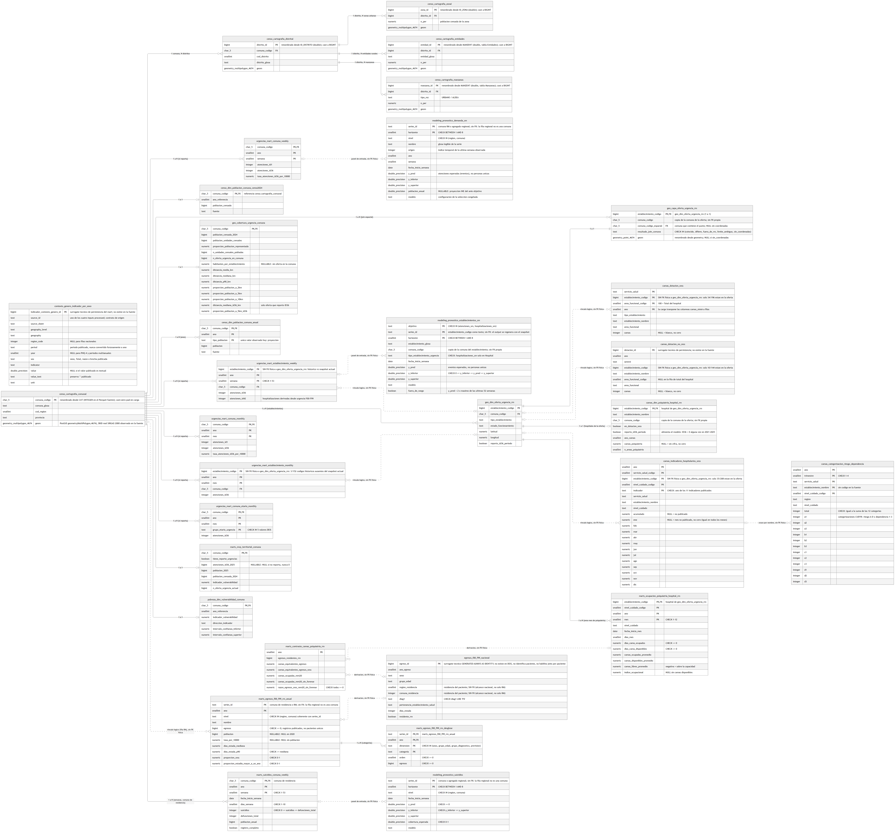

# Modelo de base de datos

Evidencia académica del ítem 15 del proyecto APT: *"Modelo de base de datos — Entidades, atributos, relaciones, PK, FK y cardinalidades — Crear diagrama entidad relación — Confirmar si existe; si no, crear desde cero a partir de requisitos y demo."*

## 1. Objetivo

Documentar de forma trazable y reproducible:

1. el **modelo lógico** de los datos analíticos canónicos tal como existen hoy en `data/processed/` (archivos Parquet/CSV, sin motor de base de datos activo), con sus entidades, atributos principales, grano, llaves y relaciones reales; y
2. el **modelo físico objetivo** para la futura persistencia en PostgreSQL con extensión PostGIS — el stack de base de datos ya definido en el `README.md` raíz del proyecto —, junto con un DDL ejecutable (`db/schema_postgresql.sql`) que crea ese esquema vacío.

## 2. Estado previo / confirmación de existencia

Se realizó una búsqueda dirigida antes de crear cualquier artefacto (estado del repositorio al iniciar el ítem, septiembre de 2026; hoy `docs/07-diagramas/` contiene además este modelo de datos y el diagrama de clases `clases_saad.*`):

- `docs/07-diagramas/`: solo contenía `casos_de_uso_saad.*` y `componentes_saad.*` (diagramas UML de casos de uso y de componentes, PlantUML). **Ningún ERD ni modelo de datos.**
- Búsqueda de extensiones `*.mmd`, `*.mermaid`, `*.puml`, `*.dbml`, `*.drawio` en todo el repositorio: solo los dos `.puml` ya mencionados (UML, no ERD).
- Búsqueda de `*.sql` relacionado con schema/modelo: **ningún archivo `.sql` existía en el repositorio antes de esta tarea.**
- Búsqueda de los términos "ERD", "entidad-relación", "modelo lógico", "modelo físico": aparecen únicamente como referencias de política en `.agents/rules.md` (estructura de `reports/`) y como pendiente futuro en `PROJECT_CONTEXT.md` ("preparar el ERD" listado en "Siguiente frente lógico aproximado"), nunca como un diagrama o modelo ya construido.

**Conclusión: no existía un modelo de base de datos previo.** Este entregable se creó desde cero a partir de los contratos reales de los datasets (esquemas Parquet, diccionarios en `reports/dictionary/`, EDA en `reports/eda/`) y de las restricciones normativas de `AGENTS.md` / `PROJECT_CONTEXT.md` / `.agents/rules.md`.

## 3. Alcance

**Incluido** (según lo solicitado explícitamente en la tarea, inspeccionado directamente sobre los Parquet/CSV publicados):

- Cartografía Censo 2024 RM: Comunal, Distrital, Zonal, Entidades, Manzanas (`data/processed/censo/Cartografia_censo2024_RM_*.parquet`).
- `dim_poblacion_comuna_censo2024`, `dim_poblacion_comuna_anual` (`data/processed/censo/`).
- `dim_vulnerabilidad_comuna` (`data/processed/pobreza/`).
- `dim_oferta_urgencia_rm` (`data/processed/geo/`).
- `mart_urgencias_comuna_weekly`, `mart_urgencias_comuna_monthly`, `mart_urgencias_establecimiento_monthly`, `mart_urgencias_establecimiento_weekly`, `mart_urgencias_comuna_etario_monthly` (`data/processed/marts/`).
- `mart_mvp_territorial_comuna` (`data/processed/marts/`).
- `cobertura_urgencia_comuna` (`data/processed/geo/`): cobertura territorial simple por distancia en línea recta (NEXT-032).
- `egresos_f00_f99_nacional_2020_2025` (`data/processed/egresos/`).
- `mart_egresos_f00_f99_rm_anual` y `mart_egresos_f00_f99_rm_desglose` (`data/processed/marts/`): perfil anual de las hospitalizaciones F00-F99 de residentes RM por comuna de residencia y para la región (`series_id` = `RM`), y su desglose por sexo, grupo de edad, bloque diagnóstico y previsión. Derivados de `egresos_f00_f99_nacional_2020_2025`; la relación con el territorio es la residencia del paciente, sin enlace por paciente ni por establecimiento. Diccionario: `reports/dictionary/diccionario_mart_egresos_f00_f99_rm.md`.
- `contraste_camas_psiquiatria_rm` (`data/processed/marts/`): contraste anual de las camas de psiquiatría ocupadas según Egresos y según REM-20 (una fila por año de la RM). Diccionario: `reports/dictionary/diccionario_contraste_camas_psiquiatria_rm.md`.
- `capa_oferta_urgencia_rm` (`data/processed/geo/`): punto (GeoParquet, EPSG 4674) de cada establecimiento de `dim_oferta_urgencia_rm`, con el resultado del join punto-en-comuna.
- `mart_contexto_genero_indicador_sexo` (`data/processed/marts/`), derivado
  de los cuatro Parquet independientes de `data/processed/contexto_genero/`.
- `dotacion_camas_snss` y `dotacion_camas_no_snss` (`data/processed/camas/`): dotación anual de camas hospitalarias (DEIS, DIGERA), un Parquet por libro de `data/raw/camas/`, con las mismas columnas que su libro.
- `indicadores_hospitalarios_snss` y `categorizacion_riesgo_dependencia` (`data/processed/estadisticas_hospitalarias/`): Estadísticas Hospitalarias REM-20 del DEIS, un Parquet por familia de libros de `data/raw/estadisticas_hospitalarias/`: indicadores mensuales por establecimiento y nivel de cuidado (solo el detalle) y categorización trimestral CUDYR.
- `mart_ocupacion_psiquiatria_hospital_rm` (`data/processed/marts/`): ocupación mensual de las camas de psiquiatría por área y hospital de la oferta RM, derivada del REM-20.
- `mart_suicidios_comuna_weekly` (`data/processed/marts/`): suicidios semanales (defunciones con causa externa X60-X84) de residentes de cada comuna RM, derivado de `defunciones_nacional`, y su pronóstico `pronostico_suicidios` (`data/processed/modeling/`). La comuna es la de residencia; no hay enlace por persona con Urgencias.
- `pronostico_demanda_sm` y `pronostico_establecimientos_sm` (`data/processed/modeling/`): pronóstico vigente a 1-8 semanas de las atenciones de salud mental por comuna y región y, por establecimiento, de las atenciones (ID36) y de las hospitalizaciones derivadas desde la urgencia (ID42, solo hospitales). Son salidas del modelo con manifiesto de procedencia, no datos observados.

**Actualización de Defunciones:** el modelo lógico incorpora
`data/processed/defunciones/defunciones_nacional.parquet`, con las 27 variables
de fuente normalizadas y las columnas de procedencia/excepciones documentadas
en `reports/dictionary/diccionario_defunciones_nacional.md`. Su grano es un
registro publicado nacional; `fuente_id` + `fuente_fila` es una clave lógica
dentro del snapshot identificado mediante SHA256. Las repeticiones de valores
se conservan. No se añaden FK a la cartografía RM ni enlaces individuales con
Urgencias/Egresos. Se evaluaron el ERD físico/DDL y el UML: el ERD físico/DDL no requieren cambio
porque este stage no incorpora Defunciones a persistencia SQL; el UML la
representa como `DefuncionNacional`, registro publicado fuente del mart de
suicidios, sin asociación con Urgencias ni Egresos. El esquema físico de este
dataset no se anticipa en esta consolidación.

**Excluido deliberadamente:**

- Catálogo CIE-10 (`data/processed/egresos/catalogo_cie10_f00_f99.csv`, `data/processed/urgencias/catalogo_f00_f99.csv`): no fue solicitado como entidad del modelo; no se inventa como tabla adicional.
- El maestro general de establecimientos de salud (`establecimientos_rm_clean.parquet`, `establecimientos_salud_clean.parquet`) no forma parte de este ítem: la tarea pidió específicamente `dim_oferta_urgencia_rm` (subconjunto vigente de oferta de urgencia), no el maestro completo.
- Archivos intermedios o de apoyo del DAG, sin grano analítico propio: los Parquet anuales de staging (`egresos_AAAA.parquet`, `urgencias_rm_AAAA.parquet`), las tablas de EDA y perfilado de Urgencias (`tabla1_*.csv` a `tabla12_*.csv`, `perfil_cobertura_sm_comuna_semanal_2021_2025.parquet`), la lista de resolución de coordenadas (`establecimientos_coordenadas_resolucion.csv`, un diagnóstico de calidad) y los cuatro Parquet de `contexto_genero/`, que ya están representados por su mart `mart_contexto_genero_indicador_sexo`.

## 4. Convenciones

- **Modelo lógico** (`modelo_datos_logico.mmd`): describe los datos **tal como existen hoy**. Los archivos Parquet/CSV en `data/processed/` **no tienen constraints SQL activos**; las PK/FK del diagrama lógico son llaves **lógicas**, verificadas empíricamente sobre los datos (sin duplicados, sin nulos, dominios subconjunto), no restricciones físicas ya implementadas.
- **Modelo físico** (`modelo_datos_fisico_postgresql.mmd` + `db/schema_postgresql.sql`): diseño **objetivo** para PostgreSQL/PostGIS. Es el stack de base de datos que el proyecto ya definió (`README.md` raíz, sección de stack tecnológico: *"Base de Datos: PostgreSQL con extensión PostGIS"*). **PostgreSQL/PostGIS es la arquitectura de persistencia objetivo, no una alternativa a futuro por decidir.** Lo que sí permanece sin implementar es el **despliegue** (AWS/RDS, Docker) y la **capa de accesibilidad geoespacial** (OSM/GTFS, isócronas; la cobertura simple por distancia en línea recta sí existe como `cobertura_urgencia_comuna`): ninguna de las dos cosas es requisito para modelar correctamente las geometrías censales que ya existen en los Parquet fuente.
- Distinción de llaves en ambos modelos:
  - **clave natural real**: existe en la fuente y es verificablemente única (ej. `CUT`/`comuna_codigo`, `establecimiento_codigo`, `ID_DISTRITO`, `ID_ZONA`, `MANZENT`).
  - **clave lógica**: combinación de columnas de grano verificada sin duplicados (ej. `comuna_codigo + ano + semana`).
  - **clave técnica propuesta**: no existe en la fuente, se propone para el modelo físico (ej. `egreso_id`).
  - **ausencia de clave natural**: declarada explícitamente cuando corresponde (Egresos).

### Contratos de contexto oficial por sexo/género

Los cuatro Parquet comparten exactamente el esquema normalizado `source_id`,
`source_sheet`, `geography_level`, `geography`, `region_code`, `period`, `year`,
`sex`, `indicator`, `value`, `value_text`, `unit`, pero no son intercambiables:

| Dataset | Grain observado | Período | Ámbito / sexo | Indicadores |
|---|---|---|---|---|
| `egresos_intento_suicida_sexo_anio` | año nacional × medida/sexo (120 filas) | 2006–2025 | Nacional; Hombres, Mujeres, Total, Mujeres/Hombres | egresos, distribución y razón de intento suicida |
| `suicidio_ratio_hm_tasas_nacional_regional` | año × nivel (nacional/regional) × medida/sexo (3790 filas) | 1997–2023 | Nacional y 16 regiones; Hombres, Mujeres, Total, Hombres/Mujeres | defunciones, población, tasa y ratio de suicidio |
| `ansiedad_depresion_sintomas_18_mas_sexo` (PHQ-4) | período nacional × medida/sexo (40 filas) | Julio 2020; nov.–dic. 2020; jun.–jul. 2021; nov. 2021 | Nacional; Hombres, Mujeres, Total, Mujeres-Hombres | población 18+, síntomas moderados/severos, porcentaje y brecha |
| `prevalencia_sintomas_depresivos_sexo` | período nacional × sexo (6 filas) | `2003`, `2009-10`, `2016-17` | Nacional; Hombres, Mujeres | prevalencia de síntomas depresivos último año |

Se elige el mart contextual normalizado `mart_contexto_genero_indicador_sexo`
porque el contrato de columnas es idéntico y `source_id` conserva el contrato de
cada fuente. No se combinan indicadores ni se fuerza una granularidad común:
`period` se conserva como texto, `year` queda nulo para PHQ-4 y períodos no
anuales, y `value_text` conserva el valor publicado `-` de ratios regionales.
Su clave lógica verificada es `source_id, source_sheet, geography_level,
geography, region_code, period, sex, indicator, unit`; el Parquet no añade una
PK técnica. La tabla física equivalente usa una clave técnica de persistencia,
sin inventar una llave de enlace entre fuentes o dominios.

## 5. Modelo lógico

Artefactos visuales persistentes generados desde el `.mmd` con Mermaid CLI. El SVG es la versión recomendada para inspección detallada y zoom; el PNG se mantiene como preview rasterizado de alta resolución:


Fuentes: [`modelo_datos_logico.mmd`](modelo_datos_logico.mmd) (Mermaid, editable) · [`modelo_datos_logico.svg`](modelo_datos_logico.svg) (vectorial, recomendado para inspección detallada) · [`modelo_datos_logico.png`](modelo_datos_logico.png) (preview rasterizado).

Regeneración de los dos modelos (SVG y PNG se generan siempre desde su `.mmd`, nunca se editan a mano). Con Mermaid CLI 11.17.0 (`@mermaid-js/mermaid-cli`, p. ej. `npx -p @mermaid-js/mermaid-cli@11.17.0 mmdc ...`), para cada `<modelo>` en `modelo_datos_logico` y `modelo_datos_fisico_postgresql`:

```bash
mmdc -i <modelo>.mmd -o <modelo>.svg -b white
mmdc -i <modelo>.mmd -o <modelo>.png -b white -w 9000 -s 1
```

Si Puppeteer no trae su propio Chromium, `-p puppeteer.json` con `{"executablePath": "<ruta a Chrome>", "args": ["--no-sandbox"]}`. Tras regenerar, comprobar que el SVG contiene las entidades de la fuente (p. ej. `pronostico_establecimientos_sm`) y que la disposición sigue limpia (ver siguiente párrafo).

**Disposición.** Ambos `.mmd` declaran en su cabecera el motor ELK (`layout: elk`, `mergeEdges: false`) y `direction LR`: cada relación se traza ortogonal en su propia pista, sin fusionarse con otras en un punto, sin atravesar entidades y con su etiqueta sobre su propio tramo. El contenido del diagrama no depende del motor; solo su disposición. Tras cada regeneración se comprobó geométricamente sobre el SVG (cajas de entidades, trayectorias y etiquetas) que ninguna línea entra en una entidad ni roza una caja ajena (holgura mínima de 6 px), que no hay tramos superpuestos ni cruces entre líneas, que las líneas paralelas de relaciones distintas están al menos a 8 px y que ninguna etiqueta tapa una caja o una línea. Algunas relaciones se declaran desde el lado derivado (`}o..o|`) solo para evitar cruces de líneas; la relación es la misma: los vínculos lógicos entre `mart_urgencias_establecimiento_*` y `dim_oferta_urgencia_rm` (ambos diagramas), la derivación de `mart_suicidios_comuna_weekly` desde `defunciones_nacional` (lógico) y las derivaciones de los marts de egresos y del contraste desde `egresos_f00_f99_nacional` y `marts_ocupacion_psiquiatria_hospital_rm` (físico). Los PNG se generan a su tamaño natural (más de 6000 px de ancho): el SVG permite ampliar sin pérdida y el PNG se lee a escala 1:1.

```mermaid
---
config:
  layout: elk
  theme: neutral
  elk:
    mergeEdges: false
    nodePlacementStrategy: NETWORK_SIMPLEX
---
%% Modelo logico - Item 15 (Modelo de base de datos)
%% Describe los datos TAL COMO EXISTEN HOY en data/processed/ (archivos Parquet/CSV).
%% Estos archivos NO tienen constraints SQL activos; las PK/FK aqui mostradas son
%% llaves logicas inferidas y verificadas sobre los datos (ver README seccion 5 y 7),
%% no restricciones fisicas ya implementadas.
%% - Egresos NO tiene relacion de llave con Urgencias ni con establecimientos (invariante): solo
%%   tiene derivaciones agregadas por comuna de residencia (marts de egresos y contraste de camas).
%% Disposicion: motor ELK, izquierda a derecha, aristas ortogonales sin fusionar (ver README seccion 5).

erDiagram
    direction LR

    %% Una fila por registro publicado; clave logica dentro del snapshot identificado en el footer.
    %% Nacional, todas las causas; sin relacion por paciente ni FK territorial inferida.
    defunciones_nacional {
        string fuente_id PK "snapshot RAW identificado mediante SHA256"
        bigint fuente_fila PK "ordinal CSV, excluye cabecera; no identifica personas"
        string fuente_archivo "ruta relativa al proyecto"
        string registro_raw_sha256 "puede repetirse; no es PK"
        int ano_defuncion
        date fecha_defuncion "NULL si ausente o no interpretable; sin imputar"
        string sexo
        int edad_tipo "0 ignorado; 1 anios, 2 meses, 3 dias, 4 horas"
        int edad_cantidad
        string comuna_codigo_original
        string comuna_codigo "cinco digitos; no certifica validez CUT"
        string comuna_glosa "residencia segun diccionario fuente"
        string region_glosa
        string diag1 "causa basica; todas las causas"
        string capitulo_diag1
        string glosa_capitulo_diag1
        string codigo_grupo_diag1
        string glosa_grupo_diag1
        string codigo_categoria_diag1
        string glosa_categoria_diag1
        string codigo_subcategoria_diag1
        string glosa_subcategoria_diag1
        string diag2 "causa externa"
        string capitulo_diag2
        string glosa_capitulo_diag2
        string codigo_grupo_diag2
        string glosa_grupo_diag2
        string codigo_categoria_diag2
        string glosa_categoria_diag2
        string codigo_subcategoria_diag2
        string glosa_subcategoria_diag2
        string lugar_defuncion
        string fecha_defuncion_original
        string edad_tipo_original
        string edad_cantidad_original
        string_array excepciones "incidencias conservadas, sin eliminar registros"
    }

    %% grain: 1 fila = 1 comuna RM (52 filas). Ancla territorial del modelo.
    cartografia_comunal {
        int CUT PK "codigo unico territorial comuna, 5 digitos"
        string COMUNA "nombre comuna"
        string PROVINCIA
        int COD_REGION
        binary SHAPE "geometria WKB MultiPolygon, EPSG 4674"
    }

    %% grain: 1 fila = 1 distrito censal (451 filas RM, 52/52 comunas cubiertas)
    cartografia_distrital {
        double ID_DISTRITO PK "identificador distrito censal"
        int CUT FK "comuna contenedora"
        string DISTRITO "nombre distrito"
        int COD_DISTRITO "codigo distrito dentro de la comuna"
        binary SHAPE
    }

    %% grain: 1 fila = 1 zona urbana (1865 filas RM, cubre 51/52 comunas: sin San Pedro)
    cartografia_zonal {
        double ID_ZONA PK "identificador zona urbana"
        double ID_DISTRITO FK "distrito contenedor, 0 huerfanos verificado"
        int CUT "comuna, denormalizado (redundante con ID_DISTRITO->CUT)"
        double n_per "poblacion censada de la zona"
        binary SHAPE
    }

    %% grain: 1 fila = 1 entidad poblada rural dispersa (2072 filas RM, cubre 26/52 comunas)
    cartografia_entidades {
        double MANZENT PK "identificador entidad, llave real (no ID_ENTIDAD: tiene 16 duplicados)"
        double ID_DISTRITO FK "distrito contenedor, 0 huerfanos verificado"
        int CUT "comuna, denormalizado"
        string ENTIDAD "nombre entidad"
        double n_per
        binary SHAPE
    }

    %% grain: 1 fila = 1 manzana (urbana + aldea rural) (66873 filas RM, cubre 52/52 comunas)
    cartografia_manzanas {
        double MANZENT PK "identificador manzana, llave real"
        double ID_DISTRITO FK "distrito contenedor, 0 huerfanos verificado"
        int CUT "comuna, denormalizado"
        string TIPO_MZ "URBANO / ALDEA"
        double n_per
        binary SHAPE
    }

    %% grain: 1 fila = 1 comuna RM, periodo unico 2024 (52 filas)
    dim_poblacion_comuna_censo2024 {
        string comuna_codigo PK "CUT como string; equivalente a CUT de cartografia_comunal"
        string comuna_glosa
        int ano_referencia "2024, periodo unico"
        bigint poblacion_censada
        string fuente
    }

    %% grain: 1 fila = comuna x ano (260 filas = 52 comunas x 5 anos, 2021-2025)
    dim_poblacion_comuna_anual {
        string comuna_codigo PK, FK
        int ano PK "2021-2025 en este processed"
        bigint poblacion
        string tipo_poblacion "unico valor observado: proyeccion"
        string fuente
    }

    %% grain: 1 fila = 1 comuna RM, periodo unico Casen 2022 (52 filas, dimension estatica)
    dim_vulnerabilidad_comuna {
        string comuna_codigo PK, FK
        int ano_referencia "2022, periodo unico"
        double indicador_vulnerabilidad "tasa de pobreza por ingresos (SAE), no indice general"
        string direccion_indicador "mayor_valor_mayor_vulnerabilidad"
    }

    %% grain: 1 fila = 1 establecimiento con oferta de urgencia RM vigente (174 filas, snapshot actual)
    dim_oferta_urgencia_rm {
        bigint establecimiento_codigo PK "codigo DEIS"
        string comuna_codigo FK
        string tipo_establecimiento
        double latitud
        double longitud
        bool reporto_id36_periodo "evidencia descriptiva 2021-2025, no criterio de inclusion"
    }

    %% grain: 1 fila = comuna x ano x semana DEIS (13362 filas, 51/52 comunas con reporte)
    mart_urgencias_comuna_weekly {
        string comuna_codigo PK, FK
        int ano PK
        int semana PK "calendario DEIS publicado, no semana ISO"
        int atenciones_id1 "atenciones generales"
        int atenciones_id36 "atenciones salud mental (incluye ID37/R45.8)"
        double tasa_atenciones_id36_por_10000
    }

    %% grain: 1 fila = comuna x ano x mes (3060 filas, 51/52 comunas)
    mart_urgencias_comuna_monthly {
        string comuna_codigo PK, FK
        int ano PK
        int mes PK
        int atenciones_id1
        int atenciones_id36
        double tasa_atenciones_id36_por_10000
    }

    %% grain: 1 fila = establecimiento x ano x mes (8857 filas, 152 establecimientos con reporte 2021-2025)
    mart_urgencias_establecimiento_monthly {
        bigint establecimiento_codigo PK "vinculo logico a dim_oferta_urgencia_rm NO garantizado al 100%: 3/152 no estan en el snapshot actual"
        int ano PK
        int mes PK
        string comuna_codigo FK "comuna del establecimiento segun el maestro"
        int atenciones_id36
    }

    %% grain: 1 fila = establecimiento x ano x semana DEIS (38641 filas, 152 establecimientos con reporte 2021-2025)
    mart_urgencias_establecimiento_weekly {
        bigint establecimiento_codigo PK "vinculo logico a dim_oferta_urgencia_rm NO garantizado al 100%: snapshot actual vs historico"
        int ano PK
        int semana PK "semana DEIS; la 53 es un fragmento"
        string comuna_codigo FK "comuna del establecimiento segun Urgencias"
        int atenciones_id36
        int atenciones_id42 "hospitalizaciones derivadas desde urgencia F00-F99; no es componente de ID36"
    }

    %% grain: 1 fila = comuna x ano x mes x grupo etario (15300 filas, formato largo, 51/52 comunas)
    mart_urgencias_comuna_etario_monthly {
        string comuna_codigo PK, FK
        int ano PK
        int mes PK
        string grupo_etario_urgencia PK "5 grupos publicados DEIS"
        int atenciones_id36
    }

    %% grain: 1 fila = 1 comuna RM (52 filas, corte unico MVP; Vitacura incluida con metricas NULL, no reporta Urgencias)
    mart_mvp_territorial_comuna {
        string comuna_codigo PK, FK
        bool tiene_reporte_urgencias
        bigint atenciones_id36_2025 "NULL si no reporta, nunca 0"
        bigint poblacion_2025
        bigint poblacion_censada_2024
        double indicador_vulnerabilidad
        bigint n_oferta_urgencia_actual
    }

    %% grain: 1 fila = 1 comuna RM (52). Proximidad en linea recta de la poblacion censal 2024 a la oferta; no es accesibilidad (sin red vial ni GTFS)
    cobertura_urgencia_comuna {
        string comuna_codigo PK, FK
        bigint poblacion_unidades_censales "manzanas + entidades con n_per > 0"
        bigint n_oferta_urgencia_en_comuna
        double distancia_mediana_km "ponderada por poblacion"
        double distancia_p90_km
        double proporcion_poblacion_a_5km
        double distancia_mediana_id36_km "solo oferta que reporto ID36"
    }

    %% grain: 1 fila = 1 observacion publicada de un indicador contextual por sexo/genero.
    %% Normaliza la maquetacion, no homologa semanticas: source_id conserva los 4 contratos.
    %% Sin FK ni relacion con Urgencias/Egresos, aunque coincidan sexo, ano o geografia.
    mart_contexto_genero_indicador_sexo {
        string source_id "uno de los cuatro inputs processed; contrato original"
        string source_sheet
        string geography_level "nacional o regional"
        string geography
        int region_code "NULL en nacional; codigo publicado en regional"
        string period "texto publicado; no se fuerza a ano"
        int year "NULL para PHQ-4 y periodos no anuales"
        string sex "incluye Total, razones y brechas publicadas"
        string indicator
        double value "NULL si el valor publicado es textual"
        string value_text "ej.: '-' publicado, no imputado"
        string unit
    }

    %% grain: 1 fila = 1 registro de egreso hospitalario publicado DEIS (218794 filas, nacional, no pacientes unicos)
    %% SIN clave natural (disociado: sin id de paciente ni de establecimiento).
    %% SIN relacion de llave con ninguna otra entidad de este modelo (invariante AGENTS.md); solo derivaciones agregadas.
    egresos_f00_f99_nacional_2020_2025 {
        int ano_egreso "sin clave natural: grano = 1 registro publicado, no deduplicado"
        string sexo "esquema incompatible en 2021 vs resto (no homologado)"
        string grupo_edad "esquema incompatible en 2021 vs resto (no homologado)"
        int region_residencia "residencia del PACIENTE, no ubicacion del hospital; alcance nacional"
        int comuna_residencia "residencia del PACIENTE, no ubicacion del hospital; alcance nacional"
        string diag1 "CIE-10 F00-F99 (diagnostico principal)"
        string pertenencia_establecimiento_salud "pertenencia SNSS del establecimiento; no identifica cual establecimiento"
        int dias_estada
        bool residente_rm "derivada de region_residencia; NULL si region_residencia es nula en origen"
    }

    %% grain: 1 fila = 1 territorio de residencia (52 comunas RM + la region, series_id 'RM') x 1 ano (318 filas = 53 x 6, 2020-2025)
    %% derivado de egresos_f00_f99_nacional_2020_2025 (solo residentes RM) y dim_poblacion_comuna_anual; comuna = residencia del PACIENTE, sin enlace por paciente ni establecimiento
    mart_egresos_f00_f99_rm_anual {
        string series_id PK "comuna_codigo de residencia o 'RM' (region); la fila regional no es una comuna"
        int ano PK "2020-2025"
        string nivel "region o comuna"
        string nombre
        bigint egresos "registros publicados, no pacientes unicos; 0 = cero registrado"
        bigint poblacion "NULL en 2020: la proyeccion INE parte en 2021"
        double tasa_por_10000 "NULL en 2020, sin denominador"
        double dias_estada_mediana "NULL sin egresos"
        double dias_estada_p90
        double proporcion_snss "egresos en establecimientos SNSS; no identifica cual"
        double proporcion_estadia_mayor_a_un_ano
    }

    %% grain: 1 fila = 1 territorio x 1 ano x 1 dimension x 1 categoria (7399 filas; sexo, grupo_edad, grupo_diagnostico y prevision armonizados entre anos)
    %% cada dimension suma el total del territorio y ano (1272 combinaciones verificadas)
    mart_egresos_f00_f99_rm_desglose {
        string series_id PK "FK logica a mart_egresos_f00_f99_rm_anual"
        int ano PK "FK logica a mart_egresos_f00_f99_rm_anual"
        string dimension PK "sexo, grupo_edad, grupo_diagnostico o prevision"
        string categoria PK "categoria armonizada entre anos (columnas armonizadas de Egresos)"
        int orden "posicion de presentacion dentro de la dimension"
        bigint egresos
    }

    %% grain: 1 fila = 1 ano de la RM (6 filas, 2020-2025); no es territorial
    %% contrasta camas ocupadas segun Egresos (cota superior, estada acotada al ano) y segun REM-20; no deben coincidir exactamente
    contraste_camas_psiquiatria_rm {
        int ano PK
        bigint egresos_residentes_rm "egresos F00-F99 de residentes RM"
        double camas_equivalentes_egresos "dias de estada acotados / dias del ano"
        double camas_equivalentes_egresos_snss "solo egresos en establecimientos SNSS"
        double camas_ocupadas_rem20 "dias cama ocupados de las areas de psiquiatria / dias del ano"
        double camas_ocupadas_rem20_sin_forense
        double razon_egresos_snss_rem20_sin_forense
    }

    %% grain: 1 fila = 1 establecimiento de dim_oferta_urgencia_rm (174 filas), como punto georreferenciado (GeoParquet, EPSG 4674)
    %% el join punto-en-comuna marca (no corrige) las discrepancias con la comuna declarada
    capa_oferta_urgencia_rm {
        bigint establecimiento_codigo PK "FK logica a dim_oferta_urgencia_rm (1 a 1)"
        string comuna_codigo "comuna declarada en la oferta"
        string comuna_codigo_espacial FK "comuna que contiene el punto; NULL sin coordenadas"
        string resultado_join_comuna "coincide, difiere, fuera_de_rm, limite_ambiguo o sin_coordenadas"
        binary geometry "punto WKB, EPSG 4674; NULL sin coordenadas"
    }

    %% grain: 1 fila = 1 serie x horizonte pronosticado desde la ultima semana observada.
    %% series_id es una comuna RM o el agregado regional; la fila regional no tiene comuna.
    %% Output del modelo, no dato observado: se regenera cuando cambia el panel o la seleccion.
    pronostico_demanda_sm {
        string series_id PK "comuna RM o agregado regional"
        int horizonte PK "semanas despues de la ultima semana observada (1-8; 4-8 es el horizonte comprometido)"
        string nivel "region o comuna"
        string nombre "glosa legible de la serie"
        int origen "indice temporal de la ultima semana observada"
        int ano
        int semana
        date fecha_inicio_semana "inicio de la semana pronosticada"
        double y_pred "atenciones esperadas (eventos), no personas unicas"
        double y_inferior "limite inferior del intervalo del modelo"
        double y_superior "limite superior del intervalo del modelo"
        double poblacion_anual "proyeccion INE del anio objetivo; no es poblacion atendida"
        string modelo "configuracion de la seleccion congelada que lo genero"
    }

    %% grain: 1 fila = 1 establecimiento x objetivo x horizonte pronosticado (1096 filas: 125 establecimientos en atenciones_sm, 12 hospitales en hospitalizaciones_sm; 8 horizontes)
    %% Output del modelo, no dato observado: se regenera cuando cambia el mart o el snapshot del anio en curso.
    %% No hay serie regional: la cifra regional es la del pronostico comunal.
    pronostico_establecimientos_sm {
        string objetivo PK "atenciones_sm (ID36) u hospitalizaciones_sm (ID42, solo hospitales)"
        string series_id PK "establecimiento_codigo como texto; vinculo logico a dim_oferta_urgencia_rm"
        int horizonte PK "1-8 semanas despues de la ultima semana observada"
        string establecimiento_glosa
        string comuna_codigo "comuna del establecimiento; no es residencia de pacientes"
        string tipo_establecimiento_urgencia "Hospital, SAPU, SAR o SUR"
        date fecha_inicio_semana "inicio de la semana pronosticada"
        double y_pred "eventos esperados (atenciones u hospitalizaciones), no personas unicas"
        double y_inferior "limite inferior del intervalo del modelo"
        double y_superior "limite superior del intervalo del modelo"
        string modelo "configuracion de la seleccion congelada del objetivo"
        bool fuera_de_rango "y_pred > 2 x maximo de las ultimas 52 semanas; no se publica"
    }

    %% grain: 1 fila = 1 area funcional de 1 hospital del SNSS, o su fila Total (1694 filas, 196 hospitales; una columna camas_AAAA por ano 2010-2025)
    dotacion_camas_snss {
        string servicio_salud PK
        bigint establecimiento_codigo PK "vinculo logico a dim_oferta_urgencia_rm, parcial: 34/196 estan en la oferta"
        int area_funcional_codigo PK "100 = Total del hospital"
        string tipo_establecimiento
        string establecimiento_nombre
        string area_funcional
        int camas_2010 "una columna camas_AAAA por ano (16, 2010-2025); NULL = blanco, no cero"
        int camas_2025
    }

    %% grain: 1 fila = 1 area funcional de 1 establecimiento no SNSS en 1 ano, o su fila de total (4631 filas, 144 establecimientos, 2019-2025; hojas anuales apiladas)
    %% sin clave logica valida: area_funcional_codigo es NULL en la fila de total (fisico: dotacion_id tecnico)
    dotacion_camas_no_snss {
        int ano
        string seremi
        bigint establecimiento_codigo "vinculo logico a dim_oferta_urgencia_rm, parcial: 10/144 estan en la oferta"
        string establecimiento_nombre
        int area_funcional_codigo "NULL en la fila de total del hospital"
        string area_funcional
        int camas "NULL = blanco, no cero"
    }

    %% grain: 1 fila = 1 hospital de dim_oferta_urgencia_rm (45 filas), con sus camas de psiquiatria del ultimo ano de la dotacion SNSS (2025)
    %% derivada de dim_oferta_urgencia_rm + dotacion_camas_snss; los totales territoriales solo suman reporto_id36_periodo = true
    dim_camas_psiquiatria_hospital_rm {
        bigint establecimiento_codigo PK "FK logica a dim_oferta_urgencia_rm; misma llave que dotacion_camas_snss (34/45 hospitales estan en la dotacion)"
        string establecimiento_nombre
        string comuna_codigo "copia de la comuna de la oferta; sin FK propia"
        boolean en_dotacion_snss "false = hospital sin dotacion SNSS (p. ej. privado): camas NULL"
        boolean reporto_id36_periodo "alimenta el modelo: ID36 > 0 alguna vez en 2021-2025"
        int ano_camas "ultimo ano con columna camas_AAAA, detectado dinamicamente"
        double camas_psiquiatria "suma de areas de psiquiatria; NULL = sin cifra declarada, no cero"
        int n_areas_psiquiatria
    }

    %% grain: 1 fila = 1 indicador de 1 nivel de cuidado de 1 establecimiento SNSS en 1 ano, con acumulado y 12 meses (160974 filas, 208 establecimientos, 2014-2026)
    %% solo detalle: las filas agregadas del libro (Datos Pais, Datos Servicio Salud, Datos Establecimiento) quedan en RAW y se usan para conciliar
    indicadores_hospitalarios_snss {
        int ano PK
        int servicio_salud_codigo PK
        bigint establecimiento_codigo PK "vinculo logico a dim_oferta_urgencia_rm (35/208) y a dotacion_camas_snss (196/208)"
        int nivel_cuidado_codigo PK "mismo catalogo que area_funcional_codigo de la dotacion"
        string indicador PK "11 indicadores: conteos, promedio de camas y razones; solo los conteos son aditivos"
        string servicio_salud
        string establecimiento_nombre
        string nivel_cuidado
        double acumulado "suma de meses en conteos; razon o promedio del periodo en el resto"
        double ene "NULL = mes no publicado, no cero (igual en todos los meses)"
        double feb
        double mar
        double abr
        double may
        double jun
        double jul
        double ago
        double sep
        double oct
        double nov
        double dic
    }

    %% grain: 1 fila = 1 nivel de cuidado de 1 establecimiento SNSS en 1 trimestre (8834 filas, 2024-T1 a 2025-T4); el libro no trae codigo de establecimiento
    categorizacion_riesgo_dependencia {
        int ano PK
        int trimestre PK "del nombre de la publicacion; el libro solo declara el ano"
        string servicio_salud PK
        string establecimiento_nombre PK "coincide por ano, servicio y nombre exacto con indicadores_hospitalarios_snss (384/384)"
        int nivel_cuidado_codigo PK
        string region
        string nivel_cuidado
        bigint total "igual a la suma de las 12 categorias"
        bigint a1 "categorizaciones CUDYR: riesgo A-D x dependencia 1-3"
        bigint a2
        bigint a3
        bigint b1
        bigint b2
        bigint b3
        bigint c1
        bigint c2
        bigint c3
        bigint d1
        bigint d2
        bigint d3
    }

    %% grain: 1 fila = 1 area de psiquiatria de 1 hospital de la oferta RM en 1 mes publicado (3444 filas, 28 areas, 14 hospitales, 2014-2026)
    %% derivada de indicadores_hospitalarios_snss; promedio diario = dias cama / dias del mes, identidad verificada contra el promedio publicado
    mart_ocupacion_psiquiatria_hospital_rm {
        bigint establecimiento_codigo PK "FK logica a dim_oferta_urgencia_rm (solo tipo Hospital)"
        int nivel_cuidado_codigo PK "area de psiquiatria; mismo catalogo que area_funcional_codigo de la dotacion"
        int ano PK
        int mes PK "solo meses publicados; un mes no publicado no es cero"
        string nivel_cuidado
        date fecha_inicio_mes
        int dias_mes
        double dias_cama_ocupados
        double dias_cama_disponibles
        double camas_ocupadas_promedio "dias cama ocupados / dias del mes"
        double camas_disponibles_promedio "dias cama disponibles / dias del mes"
        double camas_libres_promedio "brecha; negativa = sobre la capacidad"
        double indice_ocupacional "NULL sin camas disponibles"
    }

    %% grain: 1 fila = 1 comuna de residencia RM x 1 semana DEIS (18720 filas, 52 comunas, 2020-2026), grilla completa
    %% derivada de defunciones_nacional (causa externa X60-X84); comuna = residencia, sin enlace con Urgencias por persona
    mart_suicidios_comuna_weekly {
        string comuna_codigo PK "FK logica a cartografia_comunal; comuna de residencia"
        int ano PK "anio calendario de la fecha"
        int semana PK "semana epidemiologica DEIS; 53 = fragmento de borde de anio"
        date fecha_inicio_semana
        int dias_semana "4 a 9 en los bordes de anio"
        int suicidios "0 = cero registrado, no ausencia de reporte"
        int defunciones_total "todas las causas"
        bigint poblacion_anual "proyeccion INE"
        boolean registro_completo "False en semanas finales con inscripcion pendiente"
    }

    %% grain: 1 fila = 1 serie x horizonte (52 comunas + region, 8 horizontes)
    %% Output del modelo, no dato observado: se regenera cuando cambia el mart o la seleccion.
    pronostico_suicidios {
        string series_id PK "comuna de residencia o agregado regional"
        int horizonte PK "1-8 semanas despues de la ultima semana completa"
        string nivel "region o comuna; las comunas suman la region"
        date fecha_inicio_semana
        double y_pred "suicidios esperados; en una comuna suele ser < 1"
        double y_inferior "cuantil de un conteo"
        double y_superior "cuantil de un conteo; puede quedar bajo y_pred"
        double cobertura_esperada "probabilidad del intervalo segun el modelo"
        string modelo
    }

    cartografia_comunal ||--o{ cartografia_distrital : "1 comuna, N distritos"
    cartografia_distrital ||--o{ cartografia_zonal : "1 distrito, N zonas urbanas (51/52 comunas)"
    cartografia_distrital ||--o{ cartografia_entidades : "1 distrito, N entidades rurales (26/52 comunas)"
    cartografia_distrital ||--o{ cartografia_manzanas : "1 distrito, N manzanas (52/52 comunas)"

    cartografia_comunal ||--o| dim_poblacion_comuna_censo2024 : "1 comuna, 1 poblacion censada 2024"
    cartografia_comunal ||--o{ dim_poblacion_comuna_anual : "1 comuna, N anos de proyeccion"
    cartografia_comunal ||--o| dim_vulnerabilidad_comuna : "1 comuna, 1 indicador 2022"
    cartografia_comunal ||--o{ dim_oferta_urgencia_rm : "1 comuna, N establecimientos de urgencia"

    cartografia_comunal ||--o{ mart_urgencias_comuna_weekly : "1 comuna, N semanas (si reporta)"
    cartografia_comunal ||--o{ mart_urgencias_comuna_monthly : "1 comuna, N meses (si reporta)"
    cartografia_comunal ||--o{ mart_urgencias_comuna_etario_monthly : "1 comuna, N meses x grupo etario (si reporta)"
    cartografia_comunal ||--o{ mart_urgencias_establecimiento_monthly : "1 comuna, N filas mensuales (si reporta)"
    cartografia_comunal ||--o{ mart_urgencias_establecimiento_weekly : "1 comuna, N filas semanales (si reporta)"
    cartografia_comunal ||--o| mart_mvp_territorial_comuna : "1 comuna, 1 fila MVP (52/52, incl. sin reporte)"
    cartografia_comunal ||--o| cobertura_urgencia_comuna : "1 comuna, 1 fila de cobertura (52/52)"
    mart_urgencias_comuna_weekly ||--o{ pronostico_demanda_sm : "panel semanal, N horizontes por serie"
    mart_urgencias_establecimiento_weekly ||--o{ pronostico_establecimientos_sm : "panel semanal, N horizontes por establecimiento y objetivo"

    mart_urgencias_establecimiento_monthly }o..o| dim_oferta_urgencia_rm : "vinculo logico (snapshot actual vs historico)"
    mart_urgencias_establecimiento_weekly }o..o| dim_oferta_urgencia_rm : "vinculo logico (snapshot actual vs historico)"

    dim_oferta_urgencia_rm |o..o{ dotacion_camas_snss : "vinculo logico (parcial: 34/196 en la oferta)"
    dim_oferta_urgencia_rm |o..o{ dotacion_camas_no_snss : "vinculo logico (parcial: 10/144 en la oferta)"
    dim_oferta_urgencia_rm ||--o| dim_camas_psiquiatria_hospital_rm : "1 hospital, 1 fila de camas"
    dotacion_camas_snss |o..o{ dim_camas_psiquiatria_hospital_rm : "derivacion: camas de psiquiatria del ultimo ano"
    dim_oferta_urgencia_rm |o..o{ indicadores_hospitalarios_snss : "vinculo logico (parcial: 35/208 en la oferta)"
    dotacion_camas_snss |o..o{ indicadores_hospitalarios_snss : "vinculo logico (196/208 en la dotacion)"
    indicadores_hospitalarios_snss |o..o{ categorizacion_riesgo_dependencia : "vinculo logico por nombre (sin codigo en la fuente)"
    dim_oferta_urgencia_rm ||--o{ mart_ocupacion_psiquiatria_hospital_rm : "1 hospital, N area-mes (14/45 hospitales)"
    indicadores_hospitalarios_snss |o..o{ mart_ocupacion_psiquiatria_hospital_rm : "derivacion: areas de psiquiatria del detalle"

    cartografia_comunal ||--o{ mart_suicidios_comuna_weekly : "1 comuna de residencia, N semanas (52/52)"
    cartografia_comunal ||--o{ mart_egresos_f00_f99_rm_anual : "1 comuna de residencia, N anos (52/52; la fila regional RM no es comuna)"
    cartografia_comunal ||--o{ capa_oferta_urgencia_rm : "1 comuna, N puntos por join espacial"
    mart_suicidios_comuna_weekly }o..o| defunciones_nacional : "derivacion: X60-X84 de residentes RM, sin enlace por persona"
    egresos_f00_f99_nacional_2020_2025 |o..o{ mart_egresos_f00_f99_rm_anual : "derivacion: residentes RM por comuna y ano, sin enlace por persona"
    mart_egresos_f00_f99_rm_anual ||--o{ mart_egresos_f00_f99_rm_desglose : "1 territorio-ano, N categorias"
    egresos_f00_f99_nacional_2020_2025 |o..o{ contraste_camas_psiquiatria_rm : "derivacion: dias de estada de residentes RM"
    mart_ocupacion_psiquiatria_hospital_rm |o..o{ contraste_camas_psiquiatria_rm : "derivacion: dias cama ocupados REM-20"
    dim_oferta_urgencia_rm ||--|| capa_oferta_urgencia_rm : "1 establecimiento, 1 punto (174/174)"
    mart_suicidios_comuna_weekly ||--o{ pronostico_suicidios : "panel semanal, N horizontes por serie"
```

Fuente independiente (idéntica): [`modelo_datos_logico.mmd`](modelo_datos_logico.mmd).

`egresos_f00_f99_nacional_2020_2025` aparece **sin relaciones de llave** hacia el resto del diagrama: es intencional. No existe llave compartida con Urgencias ni con establecimientos (ver sección 8, invariante de no enlace por paciente/establecimiento). Su única conexión son las **derivaciones agregadas** (línea punteada) hacia `mart_egresos_f00_f99_rm_anual` y `contraste_camas_psiquiatria_rm`, que filtran a residentes RM y agregan por comuna de residencia o por año; ese resultado, no la tabla nacional, es el que se relaciona con `cartografia_comunal`.

`dotacion_camas_snss` y `dotacion_camas_no_snss` se relacionan con el resto solo por vínculos lógicos (línea punteada), nunca por FK: `establecimiento_codigo` coincide con el de `dim_oferta_urgencia_rm` solo para 44 de sus 174 establecimientos (34 de los 196 códigos del libro SNSS y 10 de los 144 del libro no SNSS), porque esa dimensión es solo la oferta de urgencia. Todos los códigos existen en el maestro de establecimientos, que no es una entidad de este modelo. Cada Parquet replica la estructura de su libro: el SNSS trae una columna `camas_AAAA` por año (el diagrama muestra la primera y la última, `camas_2010` y `camas_2025`) y el no SNSS apila las hojas anuales. La dotación es un stock anual declarado, no ocupación ni disponibilidad en tiempo real, y no se enlaza con Egresos (que no identifica el establecimiento): cualquier relación sería territorial/ecológica. Las notas al pie, las marcas y los totales nacionales de los libros no forman parte de las entidades: siguen en el RAW. Detalle del contrato en `reports/dictionary/diccionario_dotacion_camas.md`.

`dim_camas_psiquiatria_hospital_rm` (`data/processed/camas/`, stage `build_dim_camas_psiquiatria_hospital_rm`) es la única entidad de camas con relación fuerte: es una dimensión derivada con una fila por hospital de `dim_oferta_urgencia_rm` (45), por lo que su `establecimiento_codigo` sí es FK a la oferta. Une cada hospital con sus camas de psiquiatría (suma de las áreas funcionales cuyo nombre contiene «Psiquiatr», excluida la fila Total) del último año de `dotacion_camas_snss`, detectado dinámicamente. `en_dotacion_snss = false` (11 hospitales, p. ej. privados) y los hospitales sin cifra de psiquiatría quedan con `camas_psiquiatria` nula, nunca en cero. `reporto_id36_periodo` marca los hospitales que alimentaron el modelo de demanda (ID36 > 0 alguna vez en 2021-2025): los totales territoriales de la API solo suman esos. Es dotación anual declarada, no ocupación ni disponibilidad.

`indicadores_hospitalarios_snss` y `categorizacion_riesgo_dependencia` (`data/processed/estadisticas_hospitalarias/`, stage `clean_estadisticas_hospitalarias`) son las Estadísticas Hospitalarias REM-20: actividad mensual por establecimiento y nivel de cuidado del SNSS, y categorización trimestral CUDYR. Se relacionan con el resto solo por vínculos lógicos (línea punteada): `establecimiento_codigo` y `nivel_cuidado_codigo` son la misma llave y el mismo catálogo que `establecimiento_codigo` y `area_funcional_codigo` de `dotacion_camas_snss` (196 de los 208 establecimientos están en la dotación), y solo 35 de los 208 están en `dim_oferta_urgencia_rm`, que es solo la oferta de urgencia. **Los indicadores contienen solo el detalle**: las filas agregadas que el libro intercala (`Datos País`, `Datos Servicio Salud`, `Datos Establecimiento`) no son filas de la entidad, porque sumarlas con el detalle contaría lo mismo dos o tres veces; siguen en el RAW y se usan para conciliar. La entidad mezcla conteos, un promedio y razones en la columna `indicador`: solo los conteos son aditivos. La categorización no trae código de establecimiento en la fuente, así que su vínculo con los indicadores es por año, Servicio de Salud y nombre (coinciden los 384 pares del snapshot vigente). Son estadísticas consolidadas, no ocupación en tiempo real, y no se enlazan con Egresos ni con Urgencias por paciente. Detalle en `reports/dictionary/diccionario_estadisticas_hospitalarias.md`.

`mart_ocupacion_psiquiatria_hospital_rm` (`data/processed/marts/`, stage `build_mart_ocupacion_psiquiatria_hospital_rm`) deriva del detalle de `indicadores_hospitalarios_snss` la ocupación mensual de cada **área de psiquiatría** de los hospitales de `dim_oferta_urgencia_rm`. Como solo incluye hospitales de la oferta, su `establecimiento_codigo` sí es FK a esa dimensión (14 de sus 45 hospitales tienen áreas de psiquiatría en el REM-20). El grano es el área y no el hospital porque el total oculta áreas saturadas; el total del hospital se obtiene sumando días cama. Los promedios diarios son días cama / días del mes, una identidad que la etapa verifica contra el promedio publicado por la fuente. Es estadística mensual consolidada, no ocupación en tiempo real, y no se enlaza por paciente con Urgencias ni con Egresos. Detalle en `reports/dictionary/diccionario_mart_ocupacion_psiquiatria_hospital_rm.md`.

`pronostico_establecimientos_sm` (`data/processed/modeling/`, stage `forecast_establecimientos_sm`) es el pronóstico vigente por establecimiento: una fila por establecimiento, objetivo (`atenciones_sm`, ID36, o `hospitalizaciones_sm`, ID42, solo hospitales) y horizonte de 1 a 8 semanas. Es un output del modelo, no un dato observado: se regenera cuando cambia el mart semanal por establecimiento o el snapshot del año en curso, y trae `fuera_de_rango` para los pronósticos que superan el doble del máximo de las últimas 52 semanas (no se publican). No hay serie regional: la cifra regional es la del pronóstico comunal. `series_id` es el `establecimiento_codigo` como texto (los 125 existen en `dim_oferta_urgencia_rm` en el snapshot vigente), pero la relación es lógica; la entidad se deriva de `mart_urgencias_establecimiento_weekly`. Son eventos esperados, no personas únicas; ID42 se registra donde ocurrió la urgencia, no donde quedó hospitalizado el paciente, y no hay enlace por paciente con Egresos. La `comuna_codigo` de los dos marts por establecimiento (mensual y semanal) es FK a `cartografia_comunal`, como ya declaraba el DDL: sus 51 comunas están contenidas en las 52 de la cartografía.

`mart_egresos_f00_f99_rm_anual` (`data/processed/marts/`, stage `build_mart_egresos_f00_f99_rm`) es el perfil anual de las hospitalizaciones F00-F99 de los residentes de la RM: una fila por territorio de residencia y año, con las 52 comunas y la región (`series_id` = `RM`), 318 filas (53 x 6, 2020-2025). Su `series_id` es el `comuna_codigo` de residencia o `RM`: las 52 comunas coinciden con `cartografia_comunal` (52/52, sin ninguna fuera), pero la fila regional no es una comuna, por eso la relación se dibuja con cardinalidad hacia la comuna y no se impone como FK en el modelo físico. La población es la proyección INE, que parte en 2021: en 2020 `poblacion` y `tasa_por_10000` son NULL (sin denominador, no cero). Los egresos son registros publicados, no pacientes únicos, y `proporcion_snss` indica la pertenencia SNSS del establecimiento sin identificarlo. `mart_egresos_f00_f99_rm_desglose` (7399 filas) tiene clave `series_id, ano, dimension, categoria` y su `(series_id, ano)` es FK al anual; cada dimensión suma el total del territorio y año (1272 combinaciones verificadas, 0 diferencias). `contraste_camas_psiquiatria_rm` (6 filas, una por año) contrasta las camas ocupadas según Egresos (cota superior: la estadía se acota al año) y según REM-20; no son territoriales ni deben coincidir exactamente (Egresos ubica al paciente por residencia y REM-20 por hospital). Los tres se derivan de `egresos_f00_f99_nacional_2020_2025` y, el contraste, también de `mart_ocupacion_psiquiatria_hospital_rm`, sin enlace por paciente ni por establecimiento.

`capa_oferta_urgencia_rm` (`data/processed/geo/`, stage `build_capa_oferta_urgencia_rm`) es la oferta de urgencia como puntos GeoParquet (EPSG 4674): una fila por establecimiento de `dim_oferta_urgencia_rm` (174/174, relación 1 a 1 por `establecimiento_codigo`). `resultado_join_comuna` marca, sin corregir, si la comuna que contiene el punto (`comuna_codigo_espacial`, relacionada con `cartografia_comunal`) coincide con la declarada: hoy 173 `coincide` y 1 `sin_coordenadas` (geometría NULL, sin imputar). No calcula distancias, cobertura ni isócronas.

Las capas `cartografia_zonal`, `cartografia_entidades` y `cartografia_manzanas` publican además ~150 columnas socioeconómicas (`n_*`, `prom_*`) no documentadas formalmente por el diccionario oficial del Censo 2024 (ver `reports/eda/eda_cartografia_censo2024_subcomunal.md`); no se listan en el diagrama por volumen, no porque no existan.

## 6. Modelo físico objetivo PostgreSQL/PostGIS

Artefactos visuales persistentes generados desde el `.mmd` con Mermaid CLI. El SVG es la versión recomendada para inspección detallada y zoom; el PNG se mantiene como preview rasterizado de alta resolución:



Fuentes: [`modelo_datos_fisico_postgresql.mmd`](modelo_datos_fisico_postgresql.mmd) (Mermaid, editable) · [`modelo_datos_fisico_postgresql.svg`](modelo_datos_fisico_postgresql.svg) (vectorial, recomendado para inspección detallada) · [`modelo_datos_fisico_postgresql.png`](modelo_datos_fisico_postgresql.png) (preview rasterizado).

```mermaid
---
config:
  layout: elk
  theme: neutral
  elk:
    mergeEdges: false
    nodePlacementStrategy: NETWORK_SIMPLEX
---
%% Modelo fisico OBJETIVO PostgreSQL/PostGIS - Item 15 (Modelo de base de datos)
%% Stack objetivo segun README.md raiz: "Base de Datos: PostgreSQL con extension PostGIS".
%% PostgreSQL/PostGIS es la arquitectura de persistencia OBJETIVO; el despliegue en AWS/RDS
%% y la capa de accesibilidad OSM/GTFS/isocronas NO estan implementados (ver README item 15,
%% seccion 9 "Limitaciones"). Este diagrama es coherente 1:1 con db/schema_postgresql.sql.
%% Los esquemas corresponden solo a los dominios representados en este modelo fisico
%% (censo, geo, pobreza, urgencias, marts, egresos, contexto_genero, modeling, camas),
%% con trazabilidad a sus datasets de origen; no abarcan todos los archivos processed.
%% Defunciones (registro nacional) figura solo en el modelo logico y se almacena en Parquet;
%% su agregado semanal de suicidios por comuna si se persiste (marts.suicidios_comuna_weekly).
%% Disposicion: motor ELK, izquierda a derecha, aristas ortogonales sin fusionar (ver README seccion 6).

erDiagram
    direction LR

    censo_cartografia_comunal {
        char_5 comuna_codigo PK "renombrado desde CUT (INTEGER en el Parquet fuente); cast+zero-pad en carga"
        text comuna_glosa
        smallint cod_region
        text provincia
        geometry_multipolygon_4674 geom "PostGIS geometry(MultiPolygon,4674), SRID real SIRGAS 2000 observado en la fuente"
    }

    censo_cartografia_distrital {
        bigint distrito_id PK "renombrado desde ID_DISTRITO (double); cast a BIGINT"
        char_5 comuna_codigo FK
        smallint cod_distrito
        text distrito_glosa
        geometry_multipolygon_4674 geom
    }

    censo_cartografia_zonal {
        bigint zona_id PK "renombrado desde ID_ZONA (double); cast a BIGINT"
        bigint distrito_id FK
        numeric n_per "poblacion censada de la zona"
        geometry_multipolygon_4674 geom
    }

    censo_cartografia_entidades {
        bigint entidad_id PK "renombrado desde MANZENT (double, tabla Entidades); cast a BIGINT"
        bigint distrito_id FK
        text entidad_glosa
        numeric n_per
        geometry_multipolygon_4674 geom
    }

    censo_cartografia_manzanas {
        bigint manzana_id PK "renombrado desde MANZENT (double, tabla Manzanas); cast a BIGINT"
        bigint distrito_id FK
        text tipo_mz "URBANO / ALDEA"
        numeric n_per
        geometry_multipolygon_4674 geom
    }

    censo_dim_poblacion_comuna_censo2024 {
        char_5 comuna_codigo PK, FK "referencia censo.cartografia_comunal"
        smallint ano_referencia
        bigint poblacion_censada
        text fuente
    }

    censo_dim_poblacion_comuna_anual {
        char_5 comuna_codigo PK, FK
        smallint ano PK
        text tipo_poblacion PK "unico valor observado hoy: proyeccion"
        bigint poblacion
        text fuente
    }

    pobreza_dim_vulnerabilidad_comuna {
        char_5 comuna_codigo PK, FK
        smallint ano_referencia
        numeric indicador_vulnerabilidad
        text direccion_indicador
        numeric intervalo_confianza_inferior
        numeric intervalo_confianza_superior
    }

    geo_dim_oferta_urgencia_rm {
        bigint establecimiento_codigo PK
        char_5 comuna_codigo FK
        text tipo_establecimiento
        text estado_funcionamiento
        numeric latitud
        numeric longitud
        boolean reporto_id36_periodo
    }

    geo_cobertura_urgencia_comuna {
        char_5 comuna_codigo PK, FK
        bigint poblacion_censada_2024
        bigint poblacion_unidades_censales
        numeric proporcion_poblacion_representada
        bigint n_unidades_censales_pobladas
        bigint n_oferta_urgencia_en_comuna
        numeric habitantes_por_establecimiento "NULLABLE: sin oferta en la comuna"
        numeric distancia_media_km
        numeric distancia_mediana_km
        numeric distancia_p90_km
        numeric proporcion_poblacion_a_2km
        numeric proporcion_poblacion_a_5km
        numeric proporcion_poblacion_a_10km
        numeric distancia_mediana_id36_km "solo oferta que reporto ID36"
        numeric proporcion_poblacion_a_5km_id36
    }

    geo_capa_oferta_urgencia_rm {
        bigint establecimiento_codigo PK, FK "geo_dim_oferta_urgencia_rm (1 a 1)"
        char_5 comuna_codigo "copia de la comuna de la oferta; sin FK propia"
        char_5 comuna_codigo_espacial FK "comuna que contiene el punto; NULL sin coordenadas"
        text resultado_join_comuna "CHECK IN (coincide, difiere, fuera_de_rm, limite_ambiguo, sin_coordenadas)"
        geometry_point_4674 geom "renombrado desde geometry; NULL si sin_coordenadas"
    }

    urgencias_mart_comuna_weekly {
        char_5 comuna_codigo PK, FK
        smallint ano PK
        smallint semana PK
        integer atenciones_id1
        integer atenciones_id36
        numeric tasa_atenciones_id36_por_10000
    }

    urgencias_mart_comuna_monthly {
        char_5 comuna_codigo PK, FK
        smallint ano PK
        smallint mes PK
        integer atenciones_id1
        integer atenciones_id36
        numeric tasa_atenciones_id36_por_10000
    }

    urgencias_mart_establecimiento_monthly {
        bigint establecimiento_codigo PK "SIN FK fisica a geo_dim_oferta_urgencia_rm: 3/152 codigos historicos ausentes del snapshot actual"
        smallint ano PK
        smallint mes PK
        char_5 comuna_codigo FK
        integer atenciones_id36
    }

    urgencias_mart_establecimiento_weekly {
        bigint establecimiento_codigo PK "SIN FK fisica a geo_dim_oferta_urgencia_rm: historico vs snapshot actual"
        smallint ano PK
        smallint semana PK "CHECK 1-53"
        char_5 comuna_codigo FK
        integer atenciones_id36
        integer atenciones_id42 "hospitalizaciones derivadas desde urgencia F00-F99"
    }

    urgencias_mart_comuna_etario_monthly {
        char_5 comuna_codigo PK, FK
        smallint ano PK
        smallint mes PK
        text grupo_etario_urgencia PK "CHECK IN 5 valores DEIS"
        integer atenciones_id36
    }

    marts_mvp_territorial_comuna {
        char_5 comuna_codigo PK, FK
        boolean tiene_reporte_urgencias
        bigint atenciones_id36_2025 "NULLABLE: NULL si no reporta, nunca 0"
        bigint poblacion_2025
        bigint poblacion_censada_2024
        numeric indicador_vulnerabilidad
        bigint n_oferta_urgencia_actual
    }

    modeling_pronostico_demanda_sm {
        text series_id PK "comuna RM o agregado regional; sin FK: la fila regional no es una comuna"
        smallint horizonte PK "CHECK BETWEEN 1 AND 8"
        text nivel "CHECK IN (region, comuna)"
        text nombre "glosa legible de la serie"
        integer origen "indice temporal de la ultima semana observada"
        smallint ano
        smallint semana
        date fecha_inicio_semana
        double_precision y_pred "atenciones esperadas (eventos), no personas unicas"
        double_precision y_inferior
        double_precision y_superior
        double_precision poblacion_anual "NULLABLE: proyeccion INE del anio objetivo"
        text modelo "configuracion de la seleccion congelada"
    }

    modeling_pronostico_establecimientos_sm {
        text objetivo PK "CHECK IN (atenciones_sm, hospitalizaciones_sm)"
        text series_id PK "establecimiento_codigo como texto; sin FK: el output se regenera con el snapshot"
        smallint horizonte PK "CHECK BETWEEN 1 AND 8"
        text establecimiento_glosa
        char_5 comuna_codigo "copia de la comuna del establecimiento; sin FK propia"
        text tipo_establecimiento_urgencia "CHECK: hospitalizaciones_sm solo en Hospital"
        date fecha_inicio_semana
        double_precision y_pred "eventos esperados, no personas unicas"
        double_precision y_inferior "CHECK 0 <= y_inferior <= y_pred <= y_superior"
        double_precision y_superior
        text modelo
        boolean fuera_de_rango "y_pred > 2 x maximo de las ultimas 52 semanas"
    }

    contexto_genero_indicador_por_sexo {
        bigint indicador_contexto_genero_id PK "surrogate tecnico de persistencia del mart; no existe en la fuente"
        text source_id "uno de los cuatro inputs processed; contrato de origen"
        text source_sheet
        text geography_level
        text geography
        integer region_code "NULL para filas nacionales"
        text period "periodo publicado, nunca convertido forzosamente a ano"
        smallint year "NULL para PHQ-4 y periodos multianuales"
        text sex "sexo, Total, razon o brecha publicada"
        text indicator
        double_precision value "NULL si el valor publicado es textual"
        text value_text "preserva '-' publicado"
        text unit
    }

    egresos_f00_f99_nacional {
        bigint egreso_id PK "surrogate tecnico GENERATED ALWAYS AS IDENTITY; no existe en DEIS, no identifica paciente, no habilita joins por paciente"
        smallint ano_egreso
        text sexo
        text grupo_edad
        smallint region_residencia "residencia del paciente; SIN FK (alcance nacional, no solo RM)"
        integer comuna_residencia "residencia del paciente; SIN FK (alcance nacional, no solo RM)"
        text diag1 "CHECK diag1 LIKE 'F%'"
        text pertenencia_establecimiento_salud
        integer dias_estada
        boolean residente_rm
    }

    marts_egresos_f00_f99_rm_anual {
        text series_id PK "comuna de residencia o RM; sin FK: la fila regional no es una comuna"
        smallint ano PK
        text nivel "CHECK IN (region, comuna) coherente con series_id"
        text nombre
        bigint egresos "CHECK >= 0; registros publicados, no pacientes unicos"
        bigint poblacion "NULLABLE: NULL en 2020"
        numeric tasa_por_10000 "NULLABLE: NULL sin poblacion"
        numeric dias_estada_mediana
        numeric dias_estada_p90 "CHECK >= mediana"
        numeric proporcion_snss "CHECK 0-1"
        numeric proporcion_estadia_mayor_a_un_ano "CHECK 0-1"
    }

    marts_egresos_f00_f99_rm_desglose {
        text series_id PK, FK "marts_egresos_f00_f99_rm_anual"
        smallint ano PK, FK
        text dimension PK "CHECK IN (sexo, grupo_edad, grupo_diagnostico, prevision)"
        text categoria PK
        smallint orden "CHECK >= 0"
        bigint egresos "CHECK >= 0"
    }

    marts_contraste_camas_psiquiatria_rm {
        smallint ano PK
        bigint egresos_residentes_rm
        numeric camas_equivalentes_egresos
        numeric camas_equivalentes_egresos_snss
        numeric camas_ocupadas_rem20
        numeric camas_ocupadas_rem20_sin_forense
        numeric razon_egresos_snss_rem20_sin_forense "CHECK todos >= 0"
    }

    camas_dotacion_snss {
        text servicio_salud PK
        bigint establecimiento_codigo PK "SIN FK fisica a geo_dim_oferta_urgencia_rm: solo 34/196 estan en la oferta"
        smallint area_funcional_codigo PK "100 = Total del hospital"
        smallint ano PK "la carga transpone las columnas camas_AAAA a filas"
        text tipo_establecimiento
        text establecimiento_nombre
        text area_funcional
        integer camas "NULL = blanco, no cero"
    }

    camas_dotacion_no_snss {
        bigint dotacion_id PK "surrogate tecnico de persistencia; no existe en la fuente"
        smallint ano
        text seremi
        bigint establecimiento_codigo "SIN FK fisica a geo_dim_oferta_urgencia_rm: solo 10/144 estan en la oferta"
        text establecimiento_nombre
        smallint area_funcional_codigo "NULL en la fila de total del hospital"
        text area_funcional
        integer camas "NULL = blanco, no cero"
    }

    camas_dim_psiquiatria_hospital_rm {
        bigint establecimiento_codigo PK, FK "hospital de geo_dim_oferta_urgencia_rm"
        text establecimiento_nombre
        char_5 comuna_codigo "copia de la comuna de la oferta; sin FK propia"
        boolean en_dotacion_snss
        boolean reporto_id36_periodo "alimenta el modelo: ID36 > 0 alguna vez en 2021-2025"
        smallint ano_camas
        numeric camas_psiquiatria "NULL = sin cifra, no cero"
        smallint n_areas_psiquiatria
    }

    camas_indicadores_hospitalarios_snss {
        smallint ano PK
        smallint servicio_salud_codigo PK
        bigint establecimiento_codigo PK "SIN FK fisica a geo_dim_oferta_urgencia_rm: solo 35/208 estan en la oferta"
        smallint nivel_cuidado_codigo PK
        text indicador PK "CHECK: uno de los 11 indicadores publicados"
        text servicio_salud
        text establecimiento_nombre
        text nivel_cuidado
        numeric acumulado "NULL = no publicado"
        numeric ene "NULL = mes no publicado, no cero (igual en todos los meses)"
        numeric feb
        numeric mar
        numeric abr
        numeric may
        numeric jun
        numeric jul
        numeric ago
        numeric sep
        numeric oct
        numeric nov
        numeric dic
    }

    camas_categorizacion_riesgo_dependencia {
        smallint ano PK
        smallint trimestre PK "CHECK 1-4"
        text servicio_salud PK
        text establecimiento_nombre PK "sin codigo en la fuente"
        smallint nivel_cuidado_codigo PK
        text region
        text nivel_cuidado
        integer total "CHECK: igual a la suma de las 12 categorias"
        integer a1 "categorizaciones CUDYR: riesgo A-D x dependencia 1-3"
        integer a2
        integer a3
        integer b1
        integer b2
        integer b3
        integer c1
        integer c2
        integer c3
        integer d1
        integer d2
        integer d3
    }

    marts_ocupacion_psiquiatria_hospital_rm {
        bigint establecimiento_codigo PK, FK "hospital de geo_dim_oferta_urgencia_rm"
        smallint nivel_cuidado_codigo PK
        smallint ano PK
        smallint mes PK "CHECK 1-12"
        text nivel_cuidado
        date fecha_inicio_mes
        smallint dias_mes
        numeric dias_cama_ocupados "CHECK >= 0"
        numeric dias_cama_disponibles "CHECK >= 0"
        numeric camas_ocupadas_promedio
        numeric camas_disponibles_promedio
        numeric camas_libres_promedio "negativa = sobre la capacidad"
        numeric indice_ocupacional "NULL sin camas disponibles"
    }

    marts_suicidios_comuna_weekly {
        char_5 comuna_codigo PK, FK "comuna de residencia"
        smallint ano PK
        smallint semana PK "CHECK 1-53"
        date fecha_inicio_semana
        smallint dias_semana "CHECK 1-10"
        integer suicidios "CHECK 0 <= suicidios <= defunciones_total"
        integer defunciones_total
        bigint poblacion_anual
        boolean registro_completo
    }

    modeling_pronostico_suicidios {
        text series_id PK "comuna o agregado regional; sin FK: la fila regional no es una comuna"
        smallint horizonte PK "CHECK BETWEEN 1 AND 8"
        text nivel "CHECK IN (region, comuna)"
        date fecha_inicio_semana
        double_precision y_pred "CHECK >= 0"
        double_precision y_inferior "CHECK y_inferior <= y_superior"
        double_precision y_superior
        double_precision cobertura_esperada "CHECK 0-1"
        text modelo
    }

    censo_cartografia_comunal ||--o{ censo_cartografia_distrital : "1 comuna, N distritos"
    censo_cartografia_distrital ||--o{ censo_cartografia_zonal : "1 distrito, N zonas urbanas"
    censo_cartografia_distrital ||--o{ censo_cartografia_entidades : "1 distrito, N entidades rurales"
    censo_cartografia_distrital ||--o{ censo_cartografia_manzanas : "1 distrito, N manzanas"

    censo_cartografia_comunal ||--o| censo_dim_poblacion_comuna_censo2024 : "1 a 1"
    censo_cartografia_comunal ||--o{ censo_dim_poblacion_comuna_anual : "1 a N (anos)"
    censo_cartografia_comunal ||--o| pobreza_dim_vulnerabilidad_comuna : "1 a 1"
    censo_cartografia_comunal ||--o{ geo_dim_oferta_urgencia_rm : "1 a N (establecimientos)"

    censo_cartografia_comunal ||--o{ urgencias_mart_comuna_weekly : "1 a N (si reporta)"
    censo_cartografia_comunal ||--o{ urgencias_mart_comuna_monthly : "1 a N (si reporta)"
    censo_cartografia_comunal ||--o{ urgencias_mart_comuna_etario_monthly : "1 a N (si reporta)"
    censo_cartografia_comunal ||--o{ urgencias_mart_establecimiento_monthly : "1 a N (si reporta)"
    censo_cartografia_comunal ||--o{ urgencias_mart_establecimiento_weekly : "1 a N (si reporta)"
    censo_cartografia_comunal ||--o| marts_mvp_territorial_comuna : "1 a 1"
    censo_cartografia_comunal ||--o| geo_cobertura_urgencia_comuna : "1 a 1"
    censo_cartografia_comunal ||--o{ geo_capa_oferta_urgencia_rm : "1 a N (join espacial)"
    geo_dim_oferta_urgencia_rm ||--|| geo_capa_oferta_urgencia_rm : "1 a 1"

    urgencias_mart_comuna_weekly |o..o{ modeling_pronostico_demanda_sm : "panel de entrada, sin FK fisica"
    urgencias_mart_establecimiento_weekly |o..o{ modeling_pronostico_establecimientos_sm : "panel de entrada, sin FK fisica"

    urgencias_mart_establecimiento_monthly }o..o| geo_dim_oferta_urgencia_rm : "vinculo logico, sin FK fisica"
    urgencias_mart_establecimiento_weekly }o..o| geo_dim_oferta_urgencia_rm : "vinculo logico, sin FK fisica"

    geo_dim_oferta_urgencia_rm |o..o{ camas_dotacion_snss : "vinculo logico, sin FK fisica"
    geo_dim_oferta_urgencia_rm |o..o{ camas_dotacion_no_snss : "vinculo logico, sin FK fisica"
    geo_dim_oferta_urgencia_rm ||--o| camas_dim_psiquiatria_hospital_rm : "1 a 1 (hospitales de la oferta)"
    geo_dim_oferta_urgencia_rm |o..o{ camas_indicadores_hospitalarios_snss : "vinculo logico, sin FK fisica"
    camas_indicadores_hospitalarios_snss |o..o{ camas_categorizacion_riesgo_dependencia : "cruce por nombre, sin FK fisica"
    geo_dim_oferta_urgencia_rm ||--o{ marts_ocupacion_psiquiatria_hospital_rm : "1 a N (area-mes de psiquiatria)"

    censo_cartografia_comunal ||--o{ marts_suicidios_comuna_weekly : "1 a N (semanas, comuna de residencia)"
    censo_cartografia_comunal |o..o{ marts_egresos_f00_f99_rm_anual : "vinculo logico (fila RM), sin FK fisica"
    marts_egresos_f00_f99_rm_anual ||--o{ marts_egresos_f00_f99_rm_desglose : "1 a N (categorias)"
    marts_egresos_f00_f99_rm_anual }o..o| egresos_f00_f99_nacional : "derivacion, sin FK fisica"
    marts_contraste_camas_psiquiatria_rm }o..o| egresos_f00_f99_nacional : "derivacion, sin FK fisica"
    marts_contraste_camas_psiquiatria_rm }o..o| marts_ocupacion_psiquiatria_hospital_rm : "derivacion, sin FK fisica"
    marts_suicidios_comuna_weekly |o..o{ modeling_pronostico_suicidios : "panel de entrada, sin FK fisica"
```

Fuente independiente (idéntica): [`modelo_datos_fisico_postgresql.mmd`](modelo_datos_fisico_postgresql.mmd).

**Arquitectura objetivo vs. despliegue vs. backlog** (para no confundir tres cosas distintas):

| Capa | Estado |
|---|---|
| PostgreSQL + PostGIS | **Arquitectura de persistencia objetivo ya definida** (`README.md` raíz). Este ítem entrega su DDL de creación de esquema. |
| AWS / RDS | Despliegue futuro, **no implementado**. Este DDL no asume ni configura infraestructura cloud. |
| OSM / GTFS / isócronas | Funcionalidad geoespacial de accesibilidad, **en backlog** (`PROJECT_CONTEXT.md`, "Pendientes principales"). No es requisito para modelar correctamente las geometrías censales que ya existen en los Parquet fuente; por eso las columnas `geom` sí usan tipos PostGIS nativos en este DDL. |

Los nueve esquemas PostgreSQL (`censo`, `pobreza`, `geo`, `urgencias`, `marts`, `egresos`, `contexto_genero`, `modeling`, `camas`) corresponden a los dominios incluidos en este diseño físico y mantienen trazabilidad hacia sus datasets de origen. Esta correspondencia se limita a las entidades representadas en PostgreSQL; no implica que todo subdirectorio o archivo de `data/processed/` tenga una tabla objetivo. `defunciones_nacional` está representado en el modelo lógico y almacenado actualmente solo en Parquet, sin tabla PostgreSQL definida; su agregado semanal de suicidios por comuna sí tiene tabla (`marts.suicidios_comuna_weekly`), igual que su pronóstico (`modeling.pronostico_suicidios`).

## 7. Tabla resumen

| Entidad | Grain | PK | FK | Cardinalidad principal |
|---|---|---|---|---|
| `cartografia_comunal` | 1 comuna RM (52 filas) | `comuna_codigo` | — | 1 → N distritos |
| `cartografia_distrital` | 1 distrito censal (451 filas RM) | `distrito_id` | `comuna_codigo` → `cartografia_comunal` | 1 → N zonas / entidades / manzanas |
| `cartografia_zonal` | 1 zona urbana (1865 filas RM, 51/52 comunas) | `zona_id` | `distrito_id` → `cartografia_distrital` | N → 1 distrito |
| `cartografia_entidades` | 1 entidad rural dispersa (2072 filas RM, 26/52 comunas) | `entidad_id` (= `MANZENT`, no `ID_ENTIDAD`) | `distrito_id` → `cartografia_distrital` | N → 1 distrito |
| `cartografia_manzanas` | 1 manzana urbana+aldea (66873 filas RM, 52/52 comunas) | `manzana_id` (= `MANZENT`) | `distrito_id` → `cartografia_distrital` | N → 1 distrito |
| `dim_poblacion_comuna_censo2024` | 1 comuna, periodo único 2024 (52 filas) | `comuna_codigo` | `comuna_codigo` → `cartografia_comunal` | 1 → 1 comuna |
| `dim_poblacion_comuna_anual` | comuna × año × tipo_poblacion (260 filas, 2021-2025) | `comuna_codigo, ano, tipo_poblacion` | `comuna_codigo` → `cartografia_comunal` | N → 1 comuna |
| `dim_vulnerabilidad_comuna` | 1 comuna, periodo único Casen 2022 (52 filas) | `comuna_codigo` | `comuna_codigo` → `cartografia_comunal` | 1 → 1 comuna |
| `dim_oferta_urgencia_rm` | 1 establecimiento, snapshot actual (174 filas) | `establecimiento_codigo` | `comuna_codigo` → `cartografia_comunal` | N → 1 comuna |
| `mart_urgencias_comuna_weekly` | comuna × año × semana DEIS (13362 filas, 51/52 comunas) | `comuna_codigo, ano, semana` | `comuna_codigo` → `cartografia_comunal` | N → 1 comuna |
| `mart_urgencias_comuna_monthly` | comuna × año × mes (3060 filas, 51/52 comunas) | `comuna_codigo, ano, mes` | `comuna_codigo` → `cartografia_comunal` | N → 1 comuna |
| `mart_urgencias_establecimiento_monthly` | establecimiento × año × mes (8857 filas, 152 establec. 2021-2025) | `establecimiento_codigo, ano, mes` | `comuna_codigo` → `cartografia_comunal`; vínculo lógico (no FK) a `dim_oferta_urgencia_rm` | N → 1 comuna |
| `mart_urgencias_establecimiento_weekly` | establecimiento × año × semana DEIS (38641 filas, 152 establec. 2021-2025), con ID42 | `establecimiento_codigo, ano, semana` | `comuna_codigo` → `cartografia_comunal`; vínculo lógico (no FK) a `dim_oferta_urgencia_rm` | N → 1 comuna |
| `mart_urgencias_comuna_etario_monthly` | comuna × año × mes × grupo etario (15300 filas, 51/52 comunas) | `comuna_codigo, ano, mes, grupo_etario_urgencia` | `comuna_codigo` → `cartografia_comunal` | N → 1 comuna |
| `mart_mvp_territorial_comuna` | 1 comuna, corte único MVP (52 filas) | `comuna_codigo` | `comuna_codigo` → `cartografia_comunal` | 1 → 1 comuna |
| `cobertura_urgencia_comuna` | 1 comuna, corte único (52 filas) | `comuna_codigo` | `comuna_codigo` → `cartografia_comunal` | 1 → 1 comuna |
| `capa_oferta_urgencia_rm` | 1 establecimiento de la oferta como punto (174 filas) | `establecimiento_codigo` | `establecimiento_codigo` → `dim_oferta_urgencia_rm` (1 a 1); `comuna_codigo_espacial` → `cartografia_comunal` | 1 → 1 establecimiento; N → 1 comuna |
| `mart_contexto_genero_indicador_sexo` | 1 observación publicada por sexo/género, fuente, geografía, período e indicador (3956 filas) | clave lógica: `source_id, source_sheet, geography_level, geography, region_code, period, sex, indicator, unit`; físico: `indicador_contexto_genero_id` técnico | ninguna | mart contextual aislado |
| `egresos_f00_f99_nacional_2020_2025` | 1 registro de egreso publicado, nacional (218794 filas) | sin clave natural (físico: `egreso_id` técnico) | ninguna (invariante: sin enlace por paciente/establecimiento; alcance nacional, sin FK a dimensiones exclusivas RM) | sin llave; solo derivaciones agregadas |
| `mart_egresos_f00_f99_rm_anual` | 1 territorio de residencia (52 comunas + región `RM`) x 1 año (318 filas, 2020-2025) | `series_id, ano` (clave lógica verificada) | vínculo lógico (no FK en el físico) a `cartografia_comunal`: las 52 comunas coinciden, la fila `RM` no es comuna; derivación de `egresos_f00_f99_nacional_2020_2025` | N → 1 comuna de residencia |
| `mart_egresos_f00_f99_rm_desglose` | 1 territorio x año x dimensión x categoría (7399 filas) | `series_id, ano, dimension, categoria` (clave lógica verificada) | `series_id, ano` → `mart_egresos_f00_f99_rm_anual` | N → 1 territorio-año |
| `contraste_camas_psiquiatria_rm` | 1 año de la RM (6 filas, 2020-2025), no territorial | `ano` (clave lógica verificada) | ninguna; derivación de `egresos_f00_f99_nacional_2020_2025` y `mart_ocupacion_psiquiatria_hospital_rm` | contraste anual aislado |
| `defunciones_nacional` | 1 registro de defunción publicado, nacional | clave lógica por snapshot: `fuente_id, fuente_fila`; sin constraint SQL | ninguna | entidad aislada en el modelo lógico; almacenamiento actual solo Parquet, sin tabla PostgreSQL definida |
| `dotacion_camas_snss` | 1 área funcional de 1 hospital del SNSS, o su fila Total (1694 filas, 196 hospitales; 2010-2025 como columnas `camas_AAAA`) | `servicio_salud, establecimiento_codigo, area_funcional_codigo` (clave lógica verificada; físico: `+ ano`, tras transponer los años a filas) | ninguna; vínculo lógico (no FK) a `dim_oferta_urgencia_rm` | entidad aislada |
| `dotacion_camas_no_snss` | 1 área funcional (o el total) de 1 establecimiento no SNSS en 1 año (4631 filas, 144 establecimientos, 2019-2025) | sin clave lógica sin nulos: `area_funcional_codigo` es nulo en la fila de total (físico: `dotacion_id` técnico) | ninguna; vínculo lógico (no FK) a `dim_oferta_urgencia_rm` | entidad aislada |
| `dim_camas_psiquiatria_hospital_rm` | 1 hospital de la oferta de urgencia con sus camas de psiquiatría del último año de la dotación SNSS (45 filas, 34 en dotación SNSS, 13 con cifra) | `establecimiento_codigo` | `establecimiento_codigo` → `dim_oferta_urgencia_rm` | 1 → 1 hospital de la oferta |
| `indicadores_hospitalarios_snss` | 1 indicador de 1 nivel de cuidado de 1 establecimiento SNSS en 1 año, con acumulado y 12 meses (160974 filas, 208 establecimientos, 2014-2026); solo detalle | `ano, servicio_salud_codigo, establecimiento_codigo, nivel_cuidado_codigo, indicador` | ninguna; vínculo lógico (no FK) a `dim_oferta_urgencia_rm` y `dotacion_camas_snss` | entidad aislada |
| `categorizacion_riesgo_dependencia` | 1 nivel de cuidado de 1 establecimiento SNSS en 1 trimestre (8834 filas, 2024-T1 a 2025-T4) | `ano, trimestre, servicio_salud, establecimiento_nombre, nivel_cuidado_codigo` | ninguna; vínculo lógico por nombre a `indicadores_hospitalarios_snss` (sin código en la fuente) | entidad aislada |
| `mart_ocupacion_psiquiatria_hospital_rm` | 1 área de psiquiatría de 1 hospital de la oferta en 1 mes publicado (3444 filas, 28 áreas, 14 hospitales, 2014-2026) | `establecimiento_codigo, nivel_cuidado_codigo, ano, mes` | `establecimiento_codigo` → `dim_oferta_urgencia_rm`; derivación lógica de `indicadores_hospitalarios_snss` | N → 1 hospital de la oferta |
| `mart_suicidios_comuna_weekly` | 1 comuna de residencia RM x 1 semana DEIS (18720 filas, 52 comunas, 2020-2026, grilla completa) | `comuna_codigo, ano, semana` (clave lógica verificada) | `comuna_codigo` → `cartografia_comunal`; derivación lógica de `defunciones_nacional`, sin enlace por persona | N → 1 comuna |
| `pronostico_demanda_sm` | 1 serie (comunas modelables + región) x horizonte 1-8 (408 filas) | `series_id, horizonte` (clave lógica) | panel de entrada `mart_urgencias_comuna_weekly`; sin FK: la fila regional no es una comuna | N horizontes → 1 serie |
| `pronostico_establecimientos_sm` | 1 establecimiento x objetivo x horizonte 1-8 (1096 filas: 125 establecimientos en `atenciones_sm`, 12 hospitales en `hospitalizaciones_sm`) | `objetivo, series_id, horizonte` (clave lógica verificada) | panel de entrada `mart_urgencias_establecimiento_weekly`; sin FK: `series_id` es `establecimiento_codigo` como texto y el output se regenera | N horizontes → 1 establecimiento y objetivo |
| `pronostico_suicidios` | 1 serie (52 comunas + región) x horizonte 1-8 | `series_id, horizonte` (clave lógica) | panel de entrada `mart_suicidios_comuna_weekly`; sin FK: la fila regional no es una comuna | N horizontes → 1 serie |

### Columnas del Parquet no persistidas

Las tablas físicas conservan las columnas necesarias para servir y auditar cada dataset; no replican íntegro todo Parquet. La comparación se hizo columna por columna contra los Parquet vigentes (las renombradas, como `CUT` → `comuna_codigo`, se cuentan por su equivalente). Ninguna omisión cambia el grano ni las claves: las PK del DDL se verificaron sin duplicados ni nulos sobre los datos reales. Las columnas omitidas siguen disponibles en el Parquet y se regeneran con el pipeline; si una consulta futura las necesita, se agregan a su tabla sin alterar la PK.

Las tablas que no aparecen replican todas las columnas de su Parquet (`geo.capa_oferta_urgencia_rm`, los tres marts de egresos y contraste, `marts.ocupacion_psiquiatria_hospital_rm`, `contexto_genero.indicador_por_sexo`, `camas.dotacion_no_snss`, `camas.dim_psiquiatria_hospital_rm`, `camas.indicadores_hospitalarios_snss` y `camas.categorizacion_riesgo_dependencia`) o las transponen (`camas.dotacion_snss`: las 16 columnas `camas_AAAA` pasan a las filas `ano` y `camas`).

| Tabla | Columnas del Parquet | Persistidas | No persistidas | Columnas no persistidas |
|---|---:|---:|---:|---|
| `censo.cartografia_comunal` | 11 | 5 | 6 | `OBJECTID`, `REGION`, `COD_PROVINCIA`, `SHAPE_Length`, `SHAPE_Area`, `SHAPE_bbox` |
| `censo.cartografia_distrital` | 15 | 5 | 10 | `OBJECTID`, `COD_REGION`, `REGION`, `COD_PROVINCIA`, `PROVINCIA`, `COMUNA`, `TIPO_DISTRITO`, `SHAPE_Length`, `SHAPE_Area`, `SHAPE_bbox` |
| `censo.cartografia_zonal` | 214 | 4 | 210 | 210 columnas: identificación administrativa y ~150 `n_*`/`prom_*` censales (sin diccionario oficial; ver sección 9) |
| `censo.cartografia_entidades` | 214 | 5 | 209 | 209 columnas: identificación administrativa y ~150 `n_*`/`prom_*` censales (sin diccionario oficial; ver sección 9) |
| `censo.cartografia_manzanas` | 218 | 5 | 213 | 213 columnas: identificación administrativa y ~150 `n_*`/`prom_*` censales (sin diccionario oficial; ver sección 9) |
| `censo.dim_poblacion_comuna_censo2024` | 5 | 4 | 1 | `comuna_glosa` |
| `censo.dim_poblacion_comuna_anual` | 6 | 5 | 1 | `comuna_glosa` |
| `pobreza.dim_vulnerabilidad_comuna` | 10 | 6 | 4 | `comuna_glosa`, `nombre_indicador`, `fuente`, `tipo_estimacion_sae` |
| `geo.dim_oferta_urgencia_rm` | 13 | 7 | 6 | `establecimiento_nombre`, `comuna_glosa`, `criterio_inclusion_oferta`, `reporto_id1_periodo`, `ultimo_ano_reporte_id36`, `tipo_urgencia_reportado` |
| `geo.cobertura_urgencia_comuna` | 16 | 15 | 1 | `comuna_glosa` |
| `urgencias.mart_comuna_weekly` | 25 | 6 | 19 | `comuna_glosa`, `atenciones_id35`, `atenciones_id37`, `atenciones_id38`, `atenciones_id39`, `atenciones_id40`, `atenciones_id41`, `n_establecimientos_reportantes_id1`, `n_establecimientos_reportantes_id36`, `fecha_inicio_semana`, `proporcion_id36_sobre_id1`, `proporcion_id37_sobre_id36`, `proporcion_id38_sobre_id36`, `proporcion_id39_sobre_id36`, `proporcion_id40_sobre_id36`, `proporcion_id41_sobre_id36`, `poblacion_anual`, `tasa_atenciones_id1_por_10000`, `tasa_atenciones_id35_por_10000` |
| `urgencias.mart_comuna_monthly` | 25 | 6 | 19 | `fecha_mes`, `comuna_glosa`, `atenciones_id35`, `atenciones_id37`, `atenciones_id38`, `atenciones_id39`, `atenciones_id40`, `atenciones_id41`, `n_establecimientos_reportantes_id1`, `n_establecimientos_reportantes_id36`, `proporcion_id36_sobre_id1`, `proporcion_id37_sobre_id36`, `proporcion_id38_sobre_id36`, `proporcion_id39_sobre_id36`, `proporcion_id40_sobre_id36`, `proporcion_id41_sobre_id36`, `poblacion_anual`, `tasa_atenciones_id1_por_10000`, `tasa_atenciones_id35_por_10000` |
| `urgencias.mart_comuna_etario_monthly` | 14 | 5 | 9 | `fecha_mes`, `comuna_glosa`, `atenciones_id1`, `atenciones_id35`, `atenciones_id37`, `atenciones_id38`, `atenciones_id39`, `atenciones_id40`, `atenciones_id41` |
| `urgencias.mart_establecimiento_monthly` | 22 | 5 | 17 | `fecha_mes`, `comuna_glosa`, `establecimiento_glosa`, `tipo_establecimiento_urgencia`, `atenciones_id1`, `atenciones_id35`, `atenciones_id37`, `atenciones_id38`, `atenciones_id39`, `atenciones_id40`, `atenciones_id41`, `proporcion_id36_sobre_id1`, `proporcion_id37_sobre_id36`, `proporcion_id38_sobre_id36`, `proporcion_id39_sobre_id36`, `proporcion_id40_sobre_id36`, `proporcion_id41_sobre_id36` |
| `urgencias.mart_establecimiento_weekly` | 23 | 6 | 17 | `comuna_glosa`, `establecimiento_glosa`, `tipo_establecimiento_urgencia`, `fecha_inicio_semana`, `atenciones_id1`, `atenciones_id35`, `atenciones_id37`, `atenciones_id38`, `atenciones_id39`, `atenciones_id40`, `atenciones_id41`, `proporcion_id36_sobre_id1`, `proporcion_id37_sobre_id36`, `proporcion_id38_sobre_id36`, `proporcion_id39_sobre_id36`, `proporcion_id40_sobre_id36`, `proporcion_id41_sobre_id36` |
| `marts.mart_mvp_territorial_comuna` | 32 | 7 | 25 | `comuna_glosa`, `ano_demanda`, `atenciones_id1_2025`, `atenciones_id35_2025`, `n_establecimientos_reportantes_id1_2025`, `n_establecimientos_reportantes_id36_2025`, `tasa_atenciones_id1_2025_por_10000`, `tasa_atenciones_id35_2025_por_10000`, `tasa_atenciones_id36_2025_por_10000`, `ano_poblacion`, `ano_censo`, `ano_vulnerabilidad`, `nombre_indicador_vulnerabilidad`, `direccion_indicador_vulnerabilidad`, `intervalo_confianza_inferior_vulnerabilidad`, `intervalo_confianza_superior_vulnerabilidad`, `tipo_estimacion_sae`, `oferta_temporalidad`, `n_hospitales`, `n_sapu`, `n_sar`, `n_sur`, `n_otras_excepciones`, `n_oferta_con_coordenadas`, `proporcion_oferta_con_coordenadas` |
| `marts.suicidios_comuna_weekly` | 11 | 9 | 2 | `comuna_glosa`, `fecha_fin_semana` |
| `egresos.egresos_f00_f99_nacional` | 22 | 9 | 13 | `glosa_region_residencia`, `glosa_comuna_residencia`, `prevision`, `glosa_prevision`, `diag2`, `condicion_egreso`, `interv_q`, `proced`, `error`, `sexo_armonizado`, `grupo_edad_armonizado`, `dias_estada_acotado_anual`, `estadia_mayor_a_un_ano` |
| `modeling.pronostico_demanda_sm` | 14 | 13 | 1 | `t` |
| `modeling.pronostico_establecimientos_sm` | 18 | 12 | 6 | `nivel`, `origen`, `t`, `ano`, `semana`, `maximo_observado_reciente` |
| `modeling.pronostico_suicidios` | 15 | 9 | 6 | `nombre`, `origen`, `t`, `ano`, `semana`, `poblacion_anual` |

El ERD lógico dibuja, a su vez, un subconjunto de las columnas persistidas (atributos principales, grano y claves). `egresos.egresos_f00_f99_nacional` no persiste `prevision`, `sexo_armonizado` ni `grupo_edad_armonizado`, pero el análisis por sexo, edad y previsión se publica ya agregado en `marts.egresos_f00_f99_rm_desglose`.

## 8. Decisiones de modelado (lógico → físico)

1. **`comuna_codigo` se estandariza a `CHAR(5)`.** El Parquet fuente publica el mismo valor con dos representaciones: `CUT` (INTEGER) en las capas de cartografía y `comuna_codigo` (string) en el resto de los datasets. Se verificó que ambos dominios son exactamente equivalentes (52/52 valores coinciden como string). Para que las FK físicas sean válidas (tipos compatibles), el modelo físico estandariza a `CHAR(5)` en todas las tablas y renombra `CUT` a `comuna_codigo` en `censo.cartografia_comunal`, documentado con `COMMENT ON COLUMN`.
2. **`ID_DISTRITO`, `ID_ZONA` y `MANZENT` se renombran y casean a `BIGINT`.** Son códigos enteros que el GeoParquet fuente exporta como `double` (artefacto de origen Esri/GeoParquet). Se renombran a `distrito_id`, `zona_id`, `entidad_id`/`manzana_id` por consistencia de nomenclatura con el resto del esquema; el nombre y tipo de origen se documentan en `COMMENT ON COLUMN`.
3. **`MANZENT`, no `ID_ENTIDAD`, es la llave real de `cartografia_entidades`.** Se verificó directamente sobre el Parquet que `ID_ENTIDAD` tiene 16 valores duplicados en RM (mismo nombre de entidad repetido en distritos distintos); `MANZENT` está confirmado sin nulos ni duplicados en `reports/eda/eda_cartografia_censo2024_subcomunal.md`. Usar `ID_ENTIDAD` como PK habría sido un error silencioso.
4. **No se modela una jerarquía `cartografia_zonal`/`cartografia_entidades` → `cartografia_manzanas`.** La coincidencia entre manzanas urbanas y Zonal está verificada solo por agregación (suma de `n_per` por comuna), no por una llave compartida a nivel de fila. La única jerarquía respaldada por llaves reales y verificada sin huérfanos es `cartografia_comunal → cartografia_distrital → {cartografia_zonal, cartografia_entidades, cartografia_manzanas}` vía `ID_DISTRITO`/`distrito_id`.
5. **`egreso_id` es una clave técnica (surrogate key) generada en la carga.** Egresos es un dataset disociado (sin identificador de paciente) con filas que pueden repetirse legítimamente; no existe llave natural. `egreso_id` no existe en DEIS, no identifica a una persona y no habilita joins por paciente con ningún otro dataset del modelo.
6. **`egresos_f00_f99_nacional` no tiene FK hacia ninguna dimensión territorial.** `region_residencia`/`comuna_residencia` son la residencia del paciente (no la ubicación del hospital) y el dataset es de alcance **nacional**, no solo RM. Crear una FK hacia `censo.cartografia_comunal` (exclusivamente RM) invalidaría todas las filas de residentes fuera de la Región Metropolitana; el dominio territorial no coincide. La conexión con el territorio la aporta el mart derivado `marts.egresos_f00_f99_rm_anual`, que ya filtra a residentes RM (ver decisión 17).
7. **`urgencias.mart_establecimiento_monthly.establecimiento_codigo` no tiene FK física hacia `geo.dim_oferta_urgencia_rm`.** Se verificó que 3 de los 152 `establecimiento_codigo` históricos (2021-2025) no están en el snapshot vigente de 174 establecimientos: `dim_oferta_urgencia_rm` es un snapshot **actual**, mientras que el mart es histórico. Una FK física real rompería la carga de esas 3 filas; se documenta como relación lógica no forzada, con `COMMENT ON TABLE`. La `comuna_codigo` de este mart y la del semanal sí tienen FK a `censo.cartografia_comunal` (51 comunas, todas dentro de las 52 de la cartografía).
8. **Las geometrías se modelan con tipos PostGIS nativos (`geometry(MultiPolygon, 4674)` en la cartografía y `geometry(Point, 4674)` en la capa de oferta de urgencia), no `BYTEA`.** El stack objetivo del proyecto ya incluye PostGIS (`README.md` raíz); el SRID 4674 (SIRGAS 2000) es el CRS real observado en el GeoParquet fuente (`reports/eda/eda_cartografia_censo2024_subcomunal.md`), sin ninguna reproyección.
9. **Esquemas PostgreSQL por dominio** (`censo`, `pobreza`, `geo`, `urgencias`, `marts`, `egresos`, `contexto_genero`, `modeling`, `camas`), con trazabilidad a los datasets de origen de las entidades incluidas en el modelo físico. Esta organización no asigna automáticamente tablas a todos los subdirectorios de `data/processed/`; El registro nacional de Defunciones conserva únicamente su contrato Parquet; solo su agregado de suicidios (`marts`) y el pronóstico derivado (`modeling`) tienen tabla. `contexto_genero` permanece aislado para preservar la naturaleza interpretativa de sus fuentes.
10. **Los cuatro indicadores de contexto de género alimentan `mart_contexto_genero_indicador_sexo`, no un mega-mart.** El mart canónico de serving conserva el contrato normalizado de cada input mediante `source_id`, geografía, `period`, `year`, `sex`, `indicator`, `unit`, `value` y `value_text`. La persistencia física equivalente es `contexto_genero.indicador_por_sexo`. No tiene FK hacia Urgencias, Egresos, cartografía ni otros marts; coincidir en sexo, año o geografía no habilita un join automático ni convierte estos indicadores en features.
11. **Los datos de camas se modelan como dos entidades, una por libro de origen, con las columnas de su libro.** Los libros publican la misma magnitud con estructuras distintas (Servicio de Salud frente a SEREMI, tipo de establecimiento solo en el SNSS, un año por columna frente a una hoja por año), y fusionarlos obligaría a columnas mutuamente excluyentes. En el modelo lógico, `dotacion_camas_snss` tiene clave lógica verificada `servicio_salud, establecimiento_codigo, area_funcional_codigo` (sin duplicados ni nulos, porque el total del hospital es el área `100` del propio libro). `dotacion_camas_no_snss` declara ausencia de clave lógica sin nulos: la fila de total del establecimiento no trae área, y esa fila vacía se conserva tal cual en vez de inventarle un código.
12. **En el modelo físico, el SNSS se normaliza y el no SNSS usa clave técnica.** `camas.dotacion_snss` transpone las 16 columnas `camas_AAAA` a filas (`ano`, `camas`), porque un grupo repetitivo de columnas por año no es un diseño relacional (cada año nuevo cambiaría el esquema); su PK natural es `servicio_salud, establecimiento_codigo, area_funcional_codigo, ano`. `camas.dotacion_no_snss` usa `dotacion_id`, una clave técnica de persistencia como `egreso_id` (no existe en la fuente), más un índice único sobre `ano, seremi, establecimiento_codigo, COALESCE(area_funcional_codigo, -1)` que verifica la llave lógica. Ninguna de las dos tiene FK hacia `geo.dim_oferta_urgencia_rm`: solo 44 de sus 174 establecimientos tienen registro de camas y la mayoría de los códigos de camas no está en la oferta; una FK rompería la carga. Se documenta como relación lógica no forzada, igual que en `mart_urgencias_establecimiento_monthly`.
13. **Los totales de camas por territorio salen de una dimensión derivada, no de los libros.** `dim_camas_psiquiatria_hospital_rm` une por llave (`establecimiento_codigo`, el mismo código DEIS de 6 dígitos en ambas fuentes) los hospitales de la oferta con la dotación SNSS, sin cruzar por nombre ni por el código textual `NN-NNN` de Urgencias. Conserva los 45 hospitales de la oferta para que el vínculo sea auditable y marca con `reporto_id36_periodo` cuáles alimentaron el modelo; sumar solo esos evita contar, por ejemplo, un hospital psiquiátrico que nunca reportó ID36. A diferencia de los libros de camas, su relación con la oferta sí es FK física porque la dimensión nace de ella.
14. **Los indicadores REM-20 conservan los meses como columnas.** A diferencia de `camas_AAAA`, los 12 meses son un conjunto cerrado que no crece con el tiempo, y el `acumulado` de una razón no es derivable de sus meses: transponer obligaría a codificar el acumulado como un mes ficticio. `camas.indicadores_hospitalarios_snss` replica la entidad lógica con PK natural y un `CHECK` sobre los 11 indicadores publicados; `camas.categorizacion_riesgo_dependencia` usa la llave lógica por nombre como PK (la fuente no trae código) y un `CHECK` de que el total sea la suma de sus 12 categorías. Ninguna tiene FK física: son libros de origen con establecimientos fuera de la oferta de urgencia.
15. **El intervalo del pronóstico de suicidios no exige `y_pred <= y_superior`.** Sus límites son cuantiles de un conteo entero y en una comuna la media semanal suele estar bajo 1: con media 0,06 el intervalo de 80% es 0-0 (el modelo le asigna 94%). Por eso `modeling.pronostico_suicidios` solo exige `y_inferior <= y_superior` y valores no negativos, a diferencia de `modeling.pronostico_demanda_sm`, y guarda `cobertura_esperada` (la probabilidad que el modelo asigna al intervalo).
16. **El pronóstico por establecimiento es un output regenerable, sin serie regional y sin FK.** `modeling.pronostico_establecimientos_sm` conserva del Parquet lo necesario para servir y auditar: `objetivo`, `series_id`, `horizonte`, `establecimiento_glosa`, `comuna_codigo`, `tipo_establecimiento_urgencia`, `fecha_inicio_semana`, `y_pred` con su intervalo, `modelo` y `fuera_de_rango`. No persiste `t`, `origen`, `ano`, `semana`, `nivel` (constante `establecimiento`) ni `maximo_observado_reciente`: la semana pronosticada queda identificada por `fecha_inicio_semana`. `series_id` (texto) no tiene FK a `geo.dim_oferta_urgencia_rm` ni `comuna_codigo` a `censo.cartografia_comunal`: el output se reemplaza completo con el snapshot del año en curso y la comuna es una copia de la del establecimiento, no la residencia de los pacientes. Dos `CHECK` protegen el contrato: el intervalo `0 <= y_inferior <= y_pred <= y_superior` (igual que `modeling.pronostico_demanda_sm`; verificado en las 1096 filas vigentes) y que `hospitalizaciones_sm` solo exista para establecimientos de tipo Hospital.
17. **Los marts de egresos se relacionan con la comuna de residencia, sin FK en el físico y sin enlace por paciente.** `marts.egresos_f00_f99_rm_anual` usa `series_id` (texto) con el `comuna_codigo` de residencia o `RM` para la región; el `CHECK` exige que `nivel = 'region'` sea exactamente `series_id = 'RM'` y que `nivel = 'comuna'` sea un código de cinco dígitos. Una FK a `censo.cartografia_comunal` rechazaría la fila regional (mismo caso que `modeling.pronostico_demanda_sm`); las 52 comunas sí coinciden (vínculo lógico verificado). `poblacion` y `tasa_por_10000` son nulas en 2020 y el `CHECK` exige que lo sean a la vez. `marts.egresos_f00_f99_rm_desglose` sí tiene FK compuesta `(series_id, ano)` al anual; que cada dimensión sume el total es una regla entre filas que verifica el stage y no la base. `marts.contraste_camas_psiquiatria_rm` es anual y no territorial: no lleva FK.
18. **`geo.capa_oferta_urgencia_rm` es 1 a 1 con la oferta y marca, no corrige, el join espacial.** Su PK `establecimiento_codigo` es FK a `geo.dim_oferta_urgencia_rm` (174/174) y `comuna_codigo_espacial` es FK a `censo.cartografia_comunal` (NULL si no hay coordenadas). Dos `CHECK` protegen el contrato: la geometría es NULL si y solo si `resultado_join_comuna = 'sin_coordenadas'` (no se imputan coordenadas) y un `coincide` exige igualdad con la comuna declarada. `comuna_codigo` es una copia de la oferta, sin FK propia, como en `camas.dim_psiquiatria_hospital_rm`.

## 9. Limitaciones

- **El DDL no se ejecutó contra una instancia PostgreSQL/PostGIS real**: no hay PostgreSQL, `psql` ni Docker disponibles en este entorno de ejecución. Se valida estáticamente en cada actualización; no se afirma ejecución real donde no la hubo.
- **Contraste del DDL con los Parquet vigentes.** Las 32 tablas se compararon con sus Parquet (columnas, tipos, `NOT NULL` frente a nulos reales y unicidad de la PK): 29 sin observaciones. Las otras 3 son conversiones ya documentadas en la sección 8 y no errores: `CUT` entero → `CHAR(5)` con ceros a la izquierda (cartografía comunal y distrital) y `residente_rm`, un booleano con nulos. Los `CHECK` de las tablas nuevas (pronóstico por establecimiento, marts de egresos y capa de oferta) se evaluaron sobre los datos reales sin filas que los incumplan. La carga real a PostgreSQL sigue sin ejecutarse.
- Los dos diagramas `.mmd` sí se renderizaron exitosamente con `@mermaid-js/mermaid-cli` (v11.17.0, vía `npx`, con los comandos de la sección 5) a SVG y PNG, confirmando sintaxis Mermaid válida end-to-end (no solo inspección visual). Los artefactos persistentes (`modelo_datos_logico.svg/png`, `modelo_datos_fisico_postgresql.svg/png`) se generaron directamente desde los `.mmd` vigentes, sin edición manual posterior.
- Las ~150 columnas socioeconómicas (`n_*`, `prom_*`) de `cartografia_zonal`/`cartografia_entidades`/`cartografia_manzanas` no están documentadas formalmente por el diccionario oficial del Censo 2024 (`reports/eda/eda_cartografia_censo2024_subcomunal.md`, sección 2); no se listan exhaustivamente aquí ni en el DDL por ese motivo, no por limitación de espacio únicamente.
- 6 de 66873 geometrías de `cartografia_manzanas` RM son topológicamente inválidas (autointersección de anillo, documentado en el EDA); no impide crear la columna `geometry`, pero podría afectar operaciones geométricas exactas sobre esas 6 filas específicas.
- La brecha de reconciliación poblacional entre `dim_poblacion_comuna_censo2024` (7.400.741 hab.) y la suma de `n_per` de Manzanas+Entidades (98,53%) no tiene causa determinable con los datos disponibles (ver EDA); no se modela ni se corrige aquí.
- Este modelo no implementa `CREATE EXTENSION postgis` de forma autoejecutable sin privilegios: requiere un rol con permiso de creación de extensiones en la instancia PostgreSQL de destino (documentado en el propio `db/schema_postgresql.sql`).

## 10. Relación con `db/schema_postgresql.sql`

El DDL ejecutable vive en [`db/schema_postgresql.sql`](../../../db/schema_postgresql.sql) (fuera de `docs/`, para no mezclar evidencia académica con código de infraestructura) y es coherente 1:1 con el diagrama de la sección 6 para los dominios físicos representados: mismos 9 esquemas, mismas 32 tablas, mismas PK/FK (las 21 FK del DDL están dibujadas como relación sólida y no hay relaciones sólidas sin FK), mismos tipos. El registro nacional de Defunciones no forma parte de este DDL (sí su agregado de suicidios y el pronóstico). No contiene `INSERT`/`COPY`, credenciales, AWS/RDS, Docker, usuarios ni migrations — únicamente `CREATE EXTENSION` (PostGIS), `CREATE SCHEMA`, `CREATE TABLE` con `PRIMARY KEY`/`FOREIGN KEY`/`CHECK`/`COMMENT`, y los índices básicos necesarios para las FK no cubiertas por una PK compuesta y para las columnas `geometry` (`GIST`).
