# Manual de usuario — SAAD (Sistema de Apoyo para el Análisis de la Demanda en salud mental)

> Versión revisada contra la aplicación desplegada el 2026-11-18 (datos hasta la semana 45 de 2026). La plataforma está disponible en AWS; para uso local consulte el [manual de implementación](../10-manual-implementacion/README.md).

---

## Índice

1. [¿Qué es SAAD?](#1-qué-es-saad)
2. [Acceso y requisitos](#2-acceso-y-requisitos)
3. [Página de inicio](#3-página-de-inicio)
4. [Tablero regional](#4-tablero-regional)
   - 4.1 [Barra superior y controles](#41-barra-superior-y-controles)
   - 4.2 [Gráfico de serie y pronóstico](#42-gráfico-de-serie-y-pronóstico)
   - 4.3 [Cómo leer las cifras](#43-cómo-leer-las-cifras)
   - 4.4 [Mapa comunal](#44-mapa-comunal)
   - 4.5 [Tabla de comunas](#45-tabla-de-comunas)
   - 4.6 [Suicidios en el tablero](#46-suicidios-en-el-tablero)
   - 4.7 [Hospitalizaciones](#47-hospitalizaciones)
5. [Vista de establecimientos](#5-vista-de-establecimientos)
   - 5.1 [Búsqueda y filtros](#51-búsqueda-y-filtros)
   - 5.2 [Detalle de un establecimiento](#52-detalle-de-un-establecimiento)
   - 5.3 [Ocupación de psiquiatría](#53-ocupación-de-psiquiatría)
   - 5.4 [Propuesta de camas](#54-propuesta-de-camas)
6. [Suicidios](#6-suicidios)
7. [Caracterización](#7-caracterización)
8. [Avisos, estados de carga y errores](#8-avisos-estados-de-carga-y-errores)
9. [Tema oscuro y vista móvil](#9-tema-oscuro-y-vista-móvil)
10. [Glosario](#10-glosario)
11. [Preguntas frecuentes](#11-preguntas-frecuentes)

---

## 1. ¿Qué es SAAD?

SAAD es una herramienta de apoyo a la toma de decisiones para el análisis de la demanda en salud mental de urgencias en la Región Metropolitana. Responde cuatro preguntas encadenadas:

| Pregunta | Lo que muestra |
|---|---|
| ¿Dónde se concentra la demanda? | Atenciones de urgencia por salud mental en las 52 comunas, con tasa por 10.000 habitantes y contexto de oferta y pobreza |
| ¿Cuándo podría aumentar la presión? | Proyección semanal con intervalo de predicción, para anticipar refuerzos antes de que la presión ocurra |
| ¿En qué establecimientos se sentirá? | Pronóstico de urgencias por establecimiento y de las hospitalizaciones que indican sus hospitales |
| ¿Alcanzan las camas de psiquiatría? | Ocupación mensual frente a dotación y escenario anual de camas necesarias |

**Lo que SAAD no es:** no gestiona pacientes ni cupos en tiempo real, no integra sistemas clínicos en tiempo real, no diagnostica, no hace triage y no predice riesgo individual. Es una herramienta de análisis territorial sobre fuentes agregadas.

---

## 2. Acceso y requisitos

| Requisito | Detalle |
|---|---|
| **Navegador** | Una versión reciente de Chrome, Edge, Firefox o Safari. En la prueba de compatibilidad (SAAD-CP-074) los motores Chromium, Firefox y WebKit (el de Safari) mostraron los mismos datos y controles |
| **Conexión** | Acceso a internet para la versión en AWS; red local para Docker Compose |
| **Autenticación** | No requiere usuario ni contraseña (acceso público de solo lectura) |
| **Resolución mínima** | 360 × 640 px (móvil); la experiencia óptima es de escritorio (1 280 px o más) |

La plataforma en AWS se sirve con CloudFront y no requiere instalación. Para el entorno local consulte el [manual de implementación](../10-manual-implementacion/README.md).

---

## 3. Página de inicio

Al abrir la aplicación se muestra la página de inicio con una descripción de la herramienta, las cuatro preguntas que responde, el origen de las fuentes de datos y el método de trabajo.

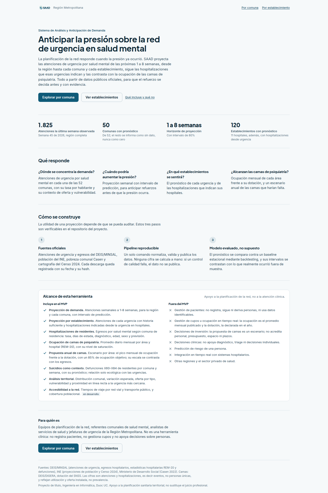

La barra superior muestra el nombre del sistema. Desde allí se accede a las dos vistas principales: **Por comuna** (el tablero) y **Por establecimiento**.

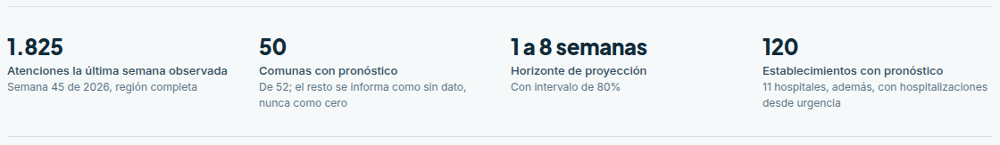

Las cifras de la portada (total de atenciones, semanas de historia, semanas de pronóstico) se cargan en vivo desde la API. Si la API no responde, la página se muestra igual sin las cifras.

Los botones **«Explorar por comuna»** y **«Ver establecimientos»** llevan a cada vista. También puede usar los enlaces de la barra superior. El logo vuelve a la página de inicio.

**Alcance:** debajo de la portada se describe el alcance contractual y las limitaciones conocidas del sistema. Léalo antes de interpretar los datos.

---

## 4. Tablero regional

El tablero (**Por comuna**) es la vista de análisis principal. Muestra la demanda de urgencias por salud mental de la Región Metropolitana o de una comuna, con pronóstico, suicidios, hospitalizaciones de residentes, mapa y tabla de comunas.

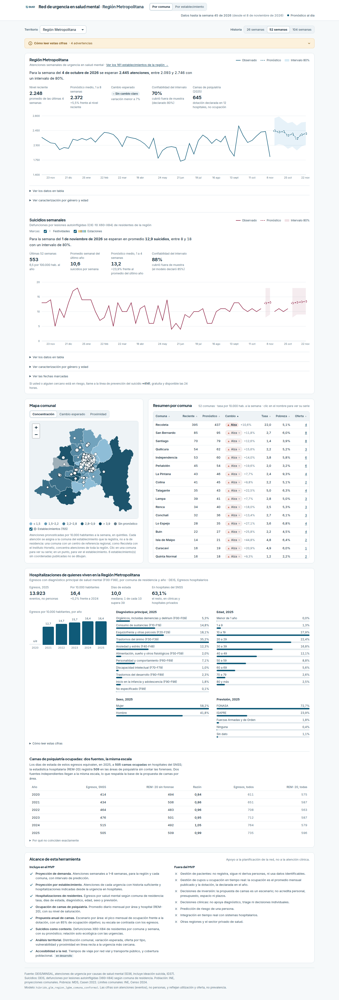

### 4.1 Barra superior y controles

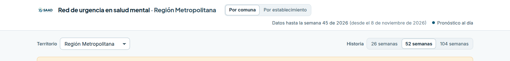

| Control | Función |
|---|---|
| **Datos hasta la semana N de AAAA** | Última semana con datos observados (corte de datos) |
| **Estado del pronóstico** | «Pronóstico al día», «Calculando pronóstico…» o «Pronóstico no disponible» (ver la [sección 8](#8-avisos-estados-de-carga-y-errores)) |
| **Territorio** | Lista para elegir la Región Metropolitana o una comuna. **«Volver a la región»** regresa a la serie regional |
| **Historia** | Cuántas semanas observadas se dibujan: 26, 52 o 104 |
| **«Ver su establecimiento →»** | Lleva a la vista de establecimientos de la comuna seleccionada |

El territorio también se puede cambiar haciendo clic en una comuna del mapa o en una fila de la tabla de comunas.

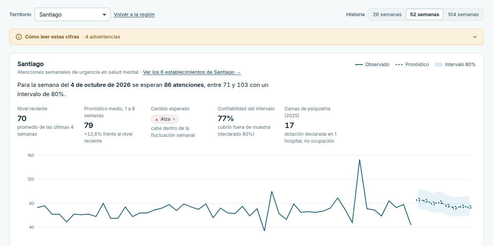

### 4.2 Gráfico de serie y pronóstico

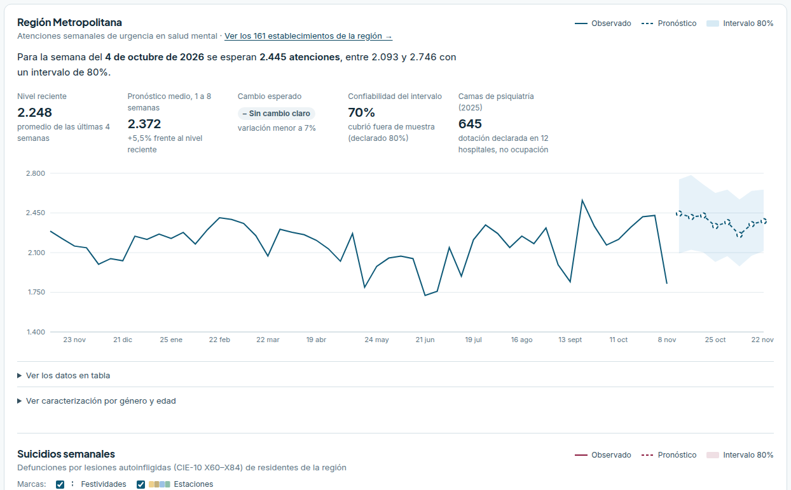

El gráfico de **atenciones semanales de urgencia en salud mental** muestra:
- **Observado:** atenciones registradas semana a semana.
- **Pronóstico:** proyección para las próximas 8 semanas.
- **Intervalo 80 %:** banda de incertidumbre del pronóstico. Fuera de muestra cubrió el 70 % de las semanas en el nivel regional y el 77 % en el comunal, por debajo del 80 % declarado: lea los límites como orientativos.

Pase el cursor sobre el gráfico para ver el valor de cada semana. **«Ver los datos en tabla»** abre las últimas 12 semanas observadas y las 8 pronosticadas, con su tipo (observado o pronóstico).

### 4.3 Cómo leer las cifras

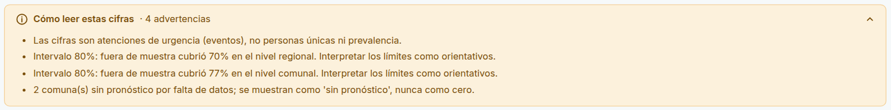

Sobre el gráfico, una frase resume la próxima semana: *«Para la semana del … se esperan N atenciones, entre A y B con un intervalo de 80 %»*. Las cifras que la acompañan son:

| Cifra | Qué significa |
|---|---|
| **Nivel reciente** | Promedio de las últimas 4 semanas observadas |
| **Pronóstico medio, 1 a 8 semanas** | Promedio semanal pronosticado y su variación frente al nivel reciente |
| **Cambio esperado** | Alza, baja o «Sin cambio claro» (variación menor al umbral). El signo **≈** indica que el cambio cabe dentro de la fluctuación semanal |
| **Confiabilidad del intervalo** | Porcentaje de semanas que el intervalo cubrió fuera de muestra, frente al 80 % declarado |

**«Cómo leer estas cifras · N advertencias»** despliega las advertencias vigentes: que las cifras son atenciones (eventos) y no personas únicas ni prevalencia, la cobertura real de los intervalos y las comunas que no tienen pronóstico.

> **Importante:** el pronóstico es orientativo. No use el punto central como un valor exacto.

### 4.4 Mapa comunal

El mapa muestra las 52 comunas de la Región Metropolitana y los establecimientos de urgencia. Puede cambiar la métrica con el selector sobre el mapa:

| Métrica | Descripción |
|---|---|
| **Concentración** | Atenciones pronosticadas por 10.000 habitantes a la semana, en quintiles |
| **Cambio esperado** | Alza, baja o sin cambio claro del pronóstico frente al nivel reciente de cada comuna |
| **Proximidad** | Distancia mediana a una urgencia que atiende salud mental; más oscuro es más lejos |

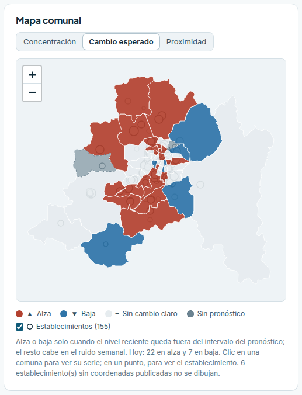

Las comunas sin pronóstico aparecen como **«Sin pronóstico»** (en proximidad, **«Sin dato»**). No significa cero atenciones: la comuna no tiene una serie confiable para modelar. Haga clic en una comuna para seleccionarla, o en un establecimiento para ver su detalle.

### 4.5 Tabla de comunas

La tabla muestra todas las comunas con sus indicadores:

| Columna | Descripción |
|---|---|
| **Comuna** | Nombre de la comuna |
| **Reciente** | Promedio semanal de las últimas 4 semanas observadas |
| **Pronóstico** | Promedio semanal pronosticado, 1 a 8 semanas |
| **Cambio** | Alza o baja según el tamaño del cambio esperado. El signo ≈ marca los que caben dentro de la fluctuación semanal |
| **Tasa** | Atenciones pronosticadas por 10.000 habitantes a la semana; no es prevalencia |
| **Pobreza** | Tasa de pobreza por ingresos, Casen 2022 |
| **Oferta** | Establecimientos de urgencia vigentes en la comuna; clic para verlos uno a uno |

Pase el cursor sobre el encabezado de cada columna para ver su definición. Haga clic en un encabezado para ordenar; las comunas sin pronóstico quedan al final. Haga clic en el nombre de una comuna para seleccionarla.

### 4.6 Suicidios en el tablero

Bajo la serie de atenciones, el bloque **«Suicidios semanales»** muestra las defunciones por suicidio de residentes del territorio seleccionado. Se detalla en la [sección 6](#6-suicidios).

### 4.7 Hospitalizaciones

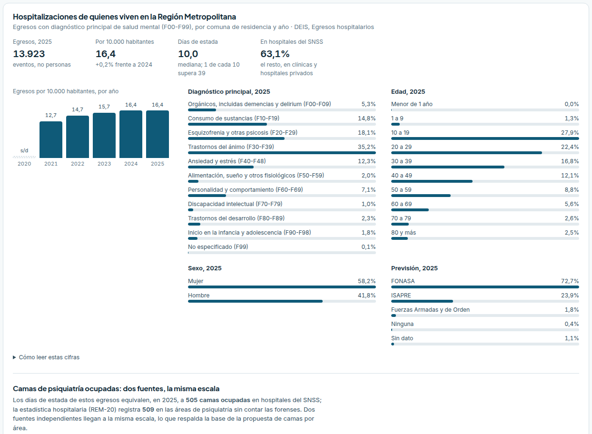

El panel **«Hospitalizaciones de quienes viven en …»** muestra los egresos hospitalarios con diagnóstico principal de salud mental (F00–F99) por comuna de **residencia** y año (DEIS, Egresos hospitalarios), en total y por 10.000 habitantes. Permite desglosar por diagnóstico principal, edad, sexo y previsión.

También compara las camas de psiquiatría ocupadas en promedio por año según Egresos y según REM-20. Las dos fuentes no coinciden exactamente: Egresos ubica al paciente por residencia y REM-20 por hospital, y el panel explica el porqué en «Por qué no coinciden exactamente».

> No confunda este panel con las **hospitalizaciones derivadas desde la urgencia (ID42)**, que se ven por hospital en la vista de establecimientos.

---

## 5. Vista de establecimientos

La vista **Por establecimiento** muestra los establecimientos de urgencia de la Región Metropolitana con su pronóstico individual.

### 5.1 Búsqueda y filtros

En la parte superior puede:
- **Elegir qué pronosticar:** atenciones de urgencia en salud mental (ID36) u hospitalizaciones derivadas desde la urgencia (ID42, solo hospitales).
- **Buscar** por nombre o comuna.
- **Filtrar** por **tipo de establecimiento** (o «Todos los tipos») y por comuna, haciendo clic en la comuna de una fila.
- **Ordenar** la tabla haciendo clic en el encabezado de una columna.

Las columnas son **Establecimiento**, **Reciente**, **Pronóstico**, **Cambio** (el mismo criterio que en la vista por comuna), **Camas psiq.** (dotación declarada de camas de psiquiatría; «—» si el establecimiento no la declara) y **Nivel de colapso**.

### 5.2 Detalle de un establecimiento

Haga clic en un establecimiento para ver su detalle:
- Serie histórica y pronóstico con intervalo del objetivo elegido.
- **Nivel reciente**, **Cambio esperado** y **Confiabilidad del intervalo**, con la misma lectura que en el tablero.
- **Camas de psiquiatría:** dotación declarada, no ocupación.

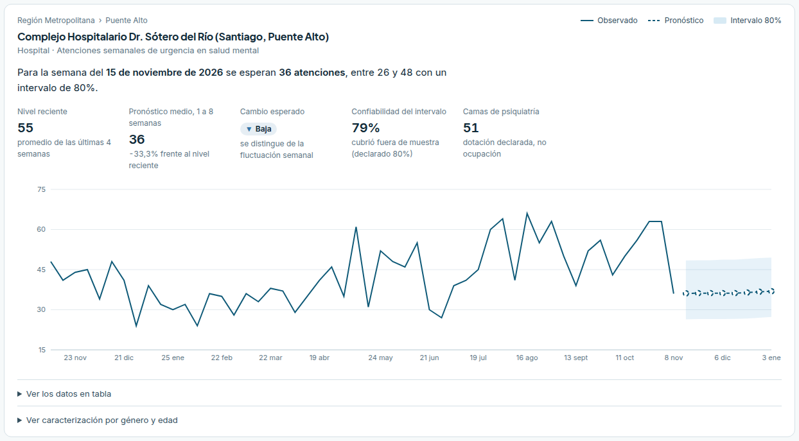

La ayuda de **«Nivel de colapso»** explica cómo se calcula la ocupación de camas de psiquiatría (días cama ocupados ÷ días cama disponibles × 100, últimos 12 meses publicados):

### 5.3 Ocupación de psiquiatría

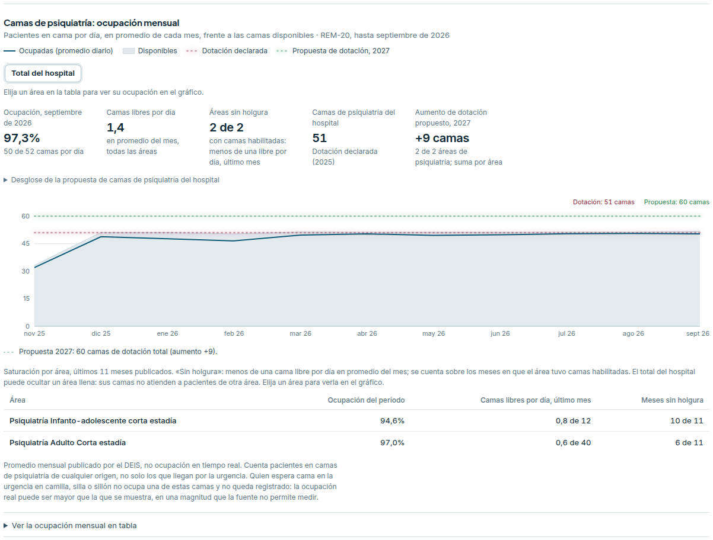

Para los hospitales con camas de psiquiatría, el panel **«Camas de psiquiatría: ocupación mensual»** muestra, por mes y por área, las camas ocupadas, disponibles y libres (fuente: DEIS, REM-20). Resume los **meses sin holgura**, las **áreas sin holgura** y las **camas libres por día** del último mes.

El nivel de colapso se muestra con un medidor de barras que crece con la gravedad:

| Nivel | Ocupación |
|---|---|
| **Holgura** | Menos de 85 % |
| **Presión** | 85–90 % |
| **Saturación** | 90 % o más |
| **Sobre la capacidad** | Más de 100 % en un área |

Los umbrales provienen del Royal College of Psychiatrists (85 %) y de Bagust et al., BMJ 1999 (90 %). REM-20 no publica sexo ni edad de quienes ocupan las camas.

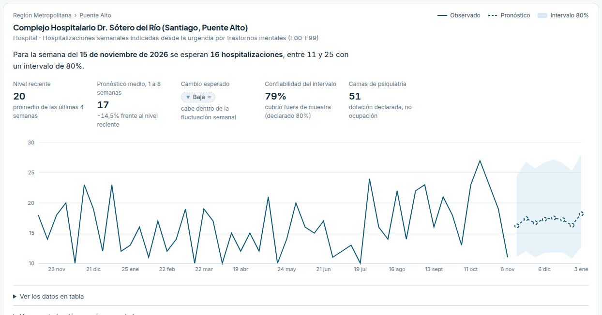

### 5.4 Propuesta de camas

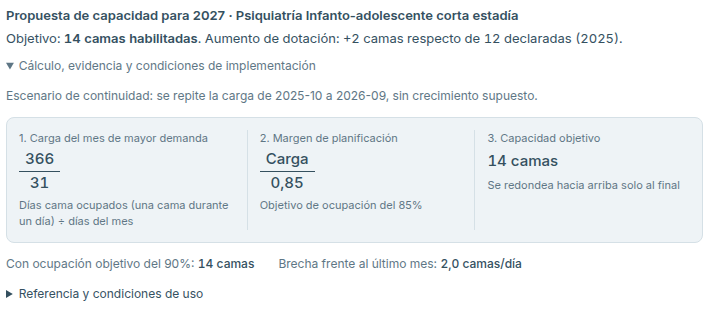

La propuesta de camas es un **escenario anual** por área de psiquiatría. Se calcula en tres pasos: (1) la carga del mes de mayor demanda, (2) un margen de planificación y (3) la capacidad objetivo con una ocupación objetivo (85 %, o 90 % donde corresponde). Muestra la **brecha frente al último mes**.

Es una estimación condicionada, no una recomendación operacional ni cupos diarios: implementarla requiere validar localmente presupuesto, personal, espacio y plazos, que estas fuentes no incluyen.

---

## 6. Suicidios

Los suicidios se consultan en el tablero, bajo la serie de atenciones, para el territorio seleccionado.

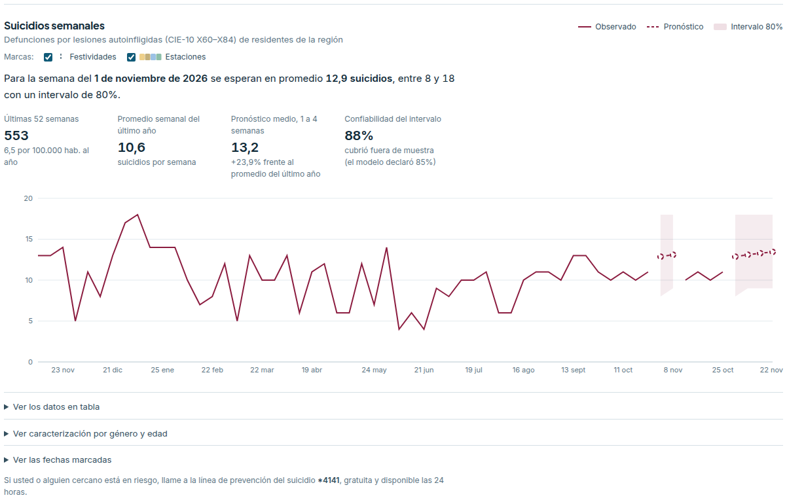

El bloque **«Suicidios semanales»** muestra las defunciones por lesiones autoinfligidas (CIE-10 X60–X84) de **residentes** del territorio:
- Serie semanal observada y **pronóstico** con intervalo de 80 %.
- **Tasa anual por 100.000 habitantes** y el promedio semanal del último año.
- **Marcas de contexto** opcionales en el gráfico: **Estaciones** y **Festividades**. «Ver las fechas marcadas» lista sus fechas.

> **Nota de interpretación:** las marcas son contexto visual, no explicaciones causales ni variables del modelo. Los datos de suicidios tienen un desfase de registro mayor que los de urgencias y las últimas semanas pueden cambiar en publicaciones posteriores del DEIS/MINSAL.

---

## 7. Caracterización

Bajo cada serie, el desplegable **«Ver caracterización por género y edad»** muestra la distribución de los eventos de las semanas observadas visibles.

- **Edad registrada:** grupos publicados por la fuente, en eventos y porcentaje.
- **Sexo:** en suicidios es el **sexo registrado**. En urgencias la fuente **no registra sexo**, por lo que se muestra un **«Escenario por sexo · no observado»**.
- **«Sin dato»** conserva los registros sin edad o sexo interpretable.

> **Advertencia:** el escenario por sexo de urgencias aplica el reparto de los egresos nacionales por intento suicida al total observado. No es sexo observado ni un reparto validado de estas urgencias. La fuente registra sexo, no identidad de género.

---

## 8. Avisos, estados de carga y errores

La barra superior informa el estado del pronóstico:

| Estado | Significado |
|---|---|
| **Pronóstico al día** | El pronóstico está listo y corresponde a los datos vigentes |
| **Calculando pronóstico…** | La API está calculando el pronóstico; aparece en unos segundos |
| **Pronóstico no disponible** | La API no pudo entregar el pronóstico |
| **Pronóstico desactualizado** | (Vista de establecimientos) el pronóstico se generó con datos anteriores a los vigentes; un aviso explica el motivo |

Otros mensajes que puede ver:

| Mensaje | Significado |
|---|---|
| **«Cargando…»** y bloques grises | La vista está pidiendo datos a la API |
| **«Pronóstico no disponible»** con un motivo, en una comuna | La comuna no tiene una serie modelable (por ejemplo, dejó de reportar o no tiene historia). **No es demanda cero.** Junto al motivo puede aparecer además el texto técnico «No se pudo consultar la API…»: si el motivo está visible, no se trata de una falla del sistema |
| **«Semana sin dato observado ni pronóstico»** | Esa semana no tiene registro; no equivale a cero |
| **«No se pudo consultar el pronóstico por establecimiento»** | La API no respondió; recargue la página o intente más tarde |

---

## 9. Tema oscuro y vista móvil

La aplicación detecta automáticamente el tema del sistema operativo (claro u oscuro).

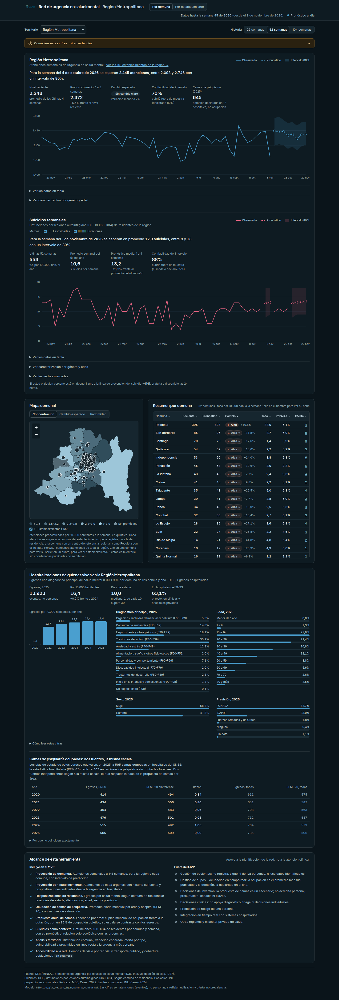

También funciona en dispositivos móviles (pantallas de 360 px o más), aunque la experiencia óptima es de escritorio.

---

## 10. Glosario

| Término | Definición |
|---|---|
| **Atención de urgencia SM (ID36)** | Atención de urgencia por causas de salud mental registrada por el DEIS/MINSAL. Cuenta eventos, no personas |
| **ID42** | Hospitalizaciones derivadas desde la urgencia con diagnóstico F00–F99, registradas por hospital |
| **Egresos hospitalarios** | Altas hospitalarias del DEIS; en SAAD se usan por comuna de residencia del paciente |
| **REM-20** | Resumen Estadístico Mensual del DEIS sobre camas; fuente de la ocupación mensual de psiquiatría |
| **Tasa por 10.000** | Atenciones pronosticadas por cada 10.000 habitantes a la semana; no es prevalencia |
| **Pronóstico** | Proyección estadística generada con un modelo evaluado por backtesting. No es un compromiso ni una certeza |
| **Intervalo de predicción al 80 %** | Rango que debería contener el 80 % de las semanas futuras. Fuera de muestra cubrió 70 % (región) y 77 % (comuna): léalo como orientativo |
| **MASE** | *Mean Absolute Scaled Error*: error del modelo dividido por el de un pronóstico ingenuo de referencia; menor que 1 es mejor que la referencia |
| **Nivel de colapso** | Clasificación de la ocupación de camas de psiquiatría: holgura, presión, saturación o sobre la capacidad |
| **SAPU** | Servicio de Atención Primaria de Urgencia |
| **SAR** | Servicio de Atención Primaria de Urgencia de Alta Resolución |
| **SUR** | Servicio de Urgencia Rural |
| **CESFAM** | Centro de Salud Familiar |
| **Desfase de registro** | Las fuentes del DEIS/MINSAL se publican con rezago; los datos de las últimas semanas pueden cambiar en publicaciones posteriores |
| **Pipeline** | Proceso automatizado que descarga, normaliza y valida los datos y genera los pronósticos |
| **Corte de datos** | Última semana con datos observados disponibles en el sistema |

---

## 11. Preguntas frecuentes

**¿Con qué frecuencia se actualizan los datos?**
Los datos se actualizan manualmente cuando el equipo ejecuta el pipeline y publica los outputs con `subir_datos.sh`. No hay actualización automática programada.

**¿Los pronósticos son definitivos?**
No. Son proyecciones estadísticas con un intervalo de incertidumbre. Deben leerse como orientación, no como predicciones exactas. El intervalo se declara al 80 %, pero fuera de muestra cubrió entre 70 % y 77 % de las semanas: más de 1 de cada 5 semanas puede quedar fuera del rango.

**¿Puedo exportar los datos?**
La interfaz no tiene función de exportación. «Ver los datos en tabla» muestra las cifras de cada serie, y los datos fuente están disponibles en el repositorio del proyecto para el equipo técnico.

**¿Por qué algunas comunas aparecen como «Sin pronóstico»?**
El mapa cubre las 52 comunas de la Región Metropolitana. Las que aparecen como «Sin pronóstico» no tienen una serie confiable para modelar (por ejemplo, dejaron de reportar o no tienen historia). No significa que tengan cero atenciones: SAAD nunca muestra la falta de dato como cero.

**¿Qué significa «Pronóstico desactualizado»?**
Aparece en la vista de establecimientos cuando el pronóstico se generó con datos anteriores a los vigentes. El aviso indica el motivo. Los valores son orientativos hasta que el equipo regenere y publique el pronóstico.

**¿La plataforma accede a datos de pacientes?**
No. Todos los datos son agregados o disociados. No hay información que permita identificar a personas individuales.

**¿Funciona sin conexión a internet?**
En la versión local (Docker Compose) la API y el frontend corren en la red local. En la versión AWS se requiere conexión a internet.

**¿Qué navegadores son compatibles?**
Versiones recientes de Chrome, Edge, Firefox y Safari. La prueba de compatibilidad (SAAD-CP-074) confirmó los mismos datos y controles en los motores Chromium, Firefox y WebKit.
