# Manual de usuario — SAAD (Sistema de Apoyo para el Análisis de la Demanda en salud mental)

> Versión correspondiente al ciclo 17 (2026-11-17). La plataforma está disponible en AWS; para uso local consulte el [manual de implementación](../10-manual-implementacion/README.md).

---

## Índice

1. [¿Qué es SAAD?](#1-qué-es-saad)
2. [Acceso y requisitos](#2-acceso-y-requisitos)
3. [Página de inicio](#3-página-de-inicio)
4. [Tablero regional](#4-tablero-regional)
   - 4.1 [Barra superior y controles](#41-barra-superior-y-controles)
   - 4.2 [Gráfico de serie y pronóstico](#42-gráfico-de-serie-y-pronóstico)
   - 4.3 [Cómo leer las cifras](#43-cómo-leer-las-cifras)
   - 4.4 [Mapa comunal](#44-mapa-comunal)
   - 4.5 [Tabla de comunas](#45-tabla-de-comunas)
   - 4.6 [Suicidios en el tablero](#46-suicidios-en-el-tablero)
   - 4.7 [Hospitalizaciones](#47-hospitalizaciones)
5. [Vista de establecimientos](#5-vista-de-establecimientos)
   - 5.1 [Búsqueda y filtros](#51-búsqueda-y-filtros)
   - 5.2 [Detalle de un establecimiento](#52-detalle-de-un-establecimiento)
   - 5.3 [Ocupación de psiquiatría](#53-ocupación-de-psiquiatría)
   - 5.4 [Propuesta de camas](#54-propuesta-de-camas)
6. [Suicidios](#6-suicidios)
7. [Caracterización](#7-caracterización)
8. [Avisos, estados de carga y errores](#8-avisos-estados-de-carga-y-errores)
9. [Tema oscuro y vista móvil](#9-tema-oscuro-y-vista-móvil)
10. [Glosario](#10-glosario)
11. [Preguntas frecuentes](#11-preguntas-frecuentes)

---

## 1. ¿Qué es SAAD?

SAAD es una herramienta de apoyo a la toma de decisiones para el análisis de la demanda en salud mental de urgencias en la Región Metropolitana. Responde cuatro preguntas encadenadas:

| Pregunta | Lo que muestra |
|---|---|
| ¿Dónde se concentra la demanda? | Atenciones de urgencia por salud mental en las 52 comunas, con tasa por habitante y contexto de oferta y vulnerabilidad |
| ¿Cuándo podría aumentar la presión? | Proyección semanal con intervalo de predicción, para anticipar refuerzos antes de que la presión ocurra |
| ¿En qué establecimientos se sentirá? | Pronóstico de urgencias por establecimiento y de las hospitalizaciones que indican sus hospitales |
| ¿Alcanzan las camas de psiquiatría? | Ocupación mensual frente a dotación y escenario anual de camas necesarias |

**Lo que SAAD no es:** no gestiona pacientes ni cupos en tiempo real, no integra sistemas clínicos en tiempo real, no diagnostica, no hace triage y no predice riesgo individual. Es una herramienta de análisis territorial sobre fuentes agregadas.

---

## 2. Acceso y requisitos

| Requisito | Detalle |
|---|---|
| **Navegador** | Chrome 120+, Firefox 120+ o Edge 120+. Safari no está soportado oficialmente |
| **Conexión** | Acceso a internet para la versión en AWS; red local para Docker Compose |
| **Autenticación** | No requiere usuario ni contraseña (acceso público de solo lectura) |
| **Resolución mínima** | 360 × 640 px (móvil); la experiencia óptima es de escritorio (1 280 px o más) |

La plataforma en AWS se sirve con CloudFront y no requiere instalación. Para el entorno local consulte el [manual de implementación](../10-manual-implementacion/README.md).

---

## 3. Página de inicio

Al abrir la aplicación se muestra la página de inicio con una descripción de la herramienta, las cuatro preguntas que responde, el origen de las fuentes de datos y el método de trabajo.

La barra superior muestra el nombre del sistema. Desde allí se accede a las dos vistas principales: **Tablero** y **Establecimientos**.

Las cifras de la portada (total de atenciones, semanas de historia, semanas de pronóstico) se cargan en vivo desde la API. Si la API no responde, la página se muestra igual sin las cifras.

El botón **«Ir al tablero»** lleva a la vista principal. También puede usar los enlaces de la barra superior.

**Alcance:** debajo de la portada se describe el alcance contractual y las limitaciones conocidas del sistema. Léalo antes de interpretar los datos.

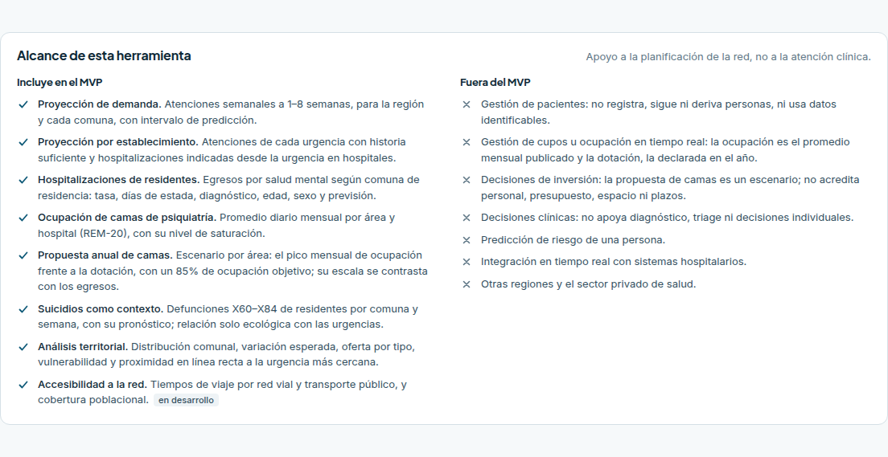

---

## 4. Tablero regional

El tablero es la vista de análisis principal. Muestra la demanda de urgencias por salud mental en la Región Metropolitana, con pronóstico, mapa y tabla de comunas.

### 4.1 Barra superior y controles

| Control | Función |
|---|---|
| Selector de territorio | Cambia la serie entre la Región (RM) y una comuna específica. Escriba el nombre de la comuna para filtrar |
| Ventana de semanas | Controla cuántas semanas de historia se muestran: 26 semanas (6 meses), 52 semanas (1 año) o 104 semanas (2 años) |
| Enlace a establecimientos | Lleva a la vista de establecimientos de la comuna seleccionada |

El territorio también se puede cambiar haciendo clic en el mapa o en una fila de la tabla de comunas.

### 4.2 Gráfico de serie y pronóstico

El gráfico muestra:
- **Línea sólida azul:** atenciones observadas semana a semana.
- **Línea discontinua:** pronóstico para las próximas semanas.
- **Banda sombreada:** intervalo de predicción al 80 % (10º–90º percentil). En un 80 % de las semanas futuras, el valor real caerá dentro de esta banda.
- **Línea de camas disponibles** (si existe): dotación de camas de psiquiatría de la zona.
- **Marcas de contexto:** festividades nacionales (Fiestas Patrias, Año Nuevo, etc.) y otros eventos de salud mental con efecto conocido en la serie.

**Desplazamiento:** pase el cursor sobre el gráfico para ver los valores exactos de cada semana en el tooltip.

### 4.3 Cómo leer las cifras

El panel de cifras muestra:
- **Atenciones esta semana / semana pasada:** número y variación respecto a la semana anterior.
- **Pronóstico próximas N semanas:** suma del intervalo central del pronóstico.
- **Semana del corte:** última semana con datos observados.

> **Importante:** el pronóstico es orientativo. El intervalo de predicción al 80 % indica la incertidumbre. No use el punto central como un valor exacto.

### 4.4 Mapa comunal

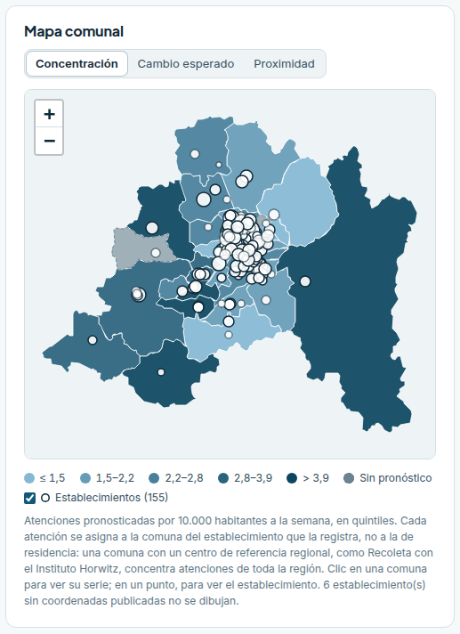

El mapa muestra las 52 comunas con atenciones de salud mental. Puede cambiar la métrica con el selector sobre el mapa:

| Métrica | Descripción |
|---|---|
| **Concentración** | Atenciones totales en el período seleccionado (escala de color por volumen) |
| **Cambio esperado** | Variación entre el pronóstico de las próximas semanas y el mismo período histórico anterior |
| **Proximidad a establecimientos** | Distancia al establecimiento de urgencias de salud mental más cercano |

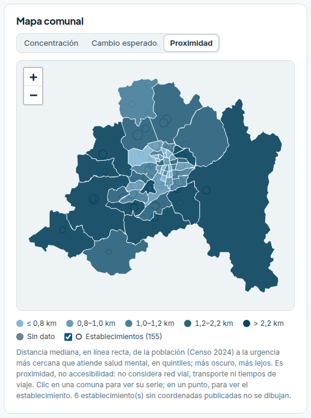

Haga clic en una comuna para seleccionarla: el gráfico y la tabla se actualizan con la serie de esa comuna.

### 4.5 Tabla de comunas

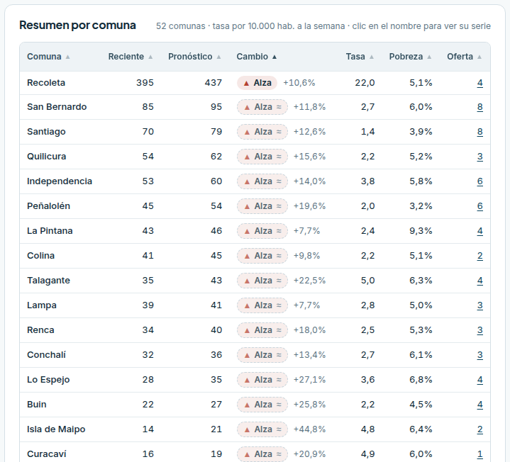

La tabla muestra todas las comunas con sus indicadores. Las columnas principales son:

| Columna | Descripción |
|---|---|
| **Comuna** | Nombre de la comuna |
| **Atenciones (período)** | Total de atenciones en la ventana de tiempo seleccionada |
| **Tasa (por 100 000 hab.)** | Atenciones por 100 000 habitantes |
| **Cambio esperado** | Variación pronósticada respecto al mismo período anterior |
| **Establecimientos** | Número de establecimientos con atenciones de salud mental |

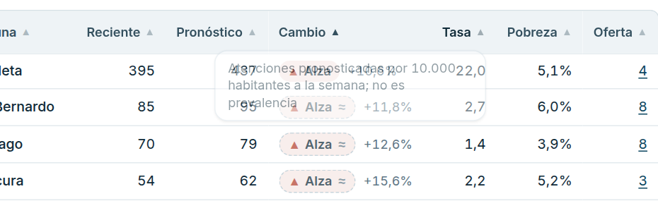

Pase el cursor sobre el encabezado de cada columna para ver su definición. Haga clic en una fila para seleccionar la comuna.

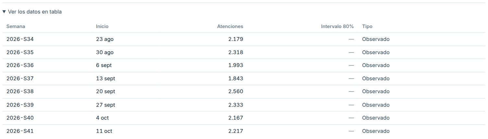

### 4.6 Suicidios en el tablero

El tablero incluye la serie de suicidios de la Región Metropolitana dentro del panel principal. Esta serie tiene un desfase de publicación distinto al de las atenciones: puede mostrar datos hasta algunas semanas antes del corte de urgencias.

### 4.7 Hospitalizaciones

El panel de hospitalizaciones muestra las derivaciones desde urgencias (ID42) por comuna y período. Los datos corresponden a egresos hospitalarios del DEIS/MINSAL.

---

## 5. Vista de establecimientos

La vista de establecimientos muestra todos los establecimientos de urgencias de salud mental en la Región Metropolitana con sus indicadores individuales.

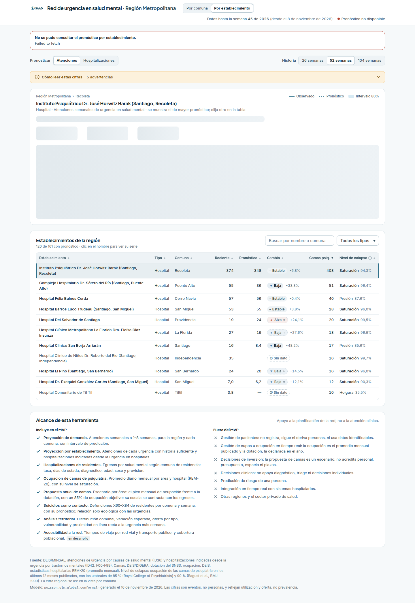

### 5.1 Búsqueda y filtros

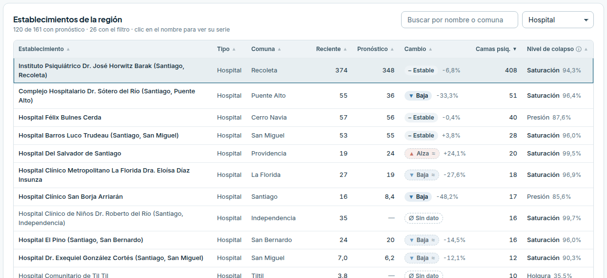

En la parte superior puede:
- **Buscar** por nombre del establecimiento.
- **Filtrar por tipo** (Hospital, SAPU, SAPU-Avanzado, etc.).
- **Ordenar** la tabla por cualquier columna haciendo clic en su encabezado.

### 5.2 Detalle de un establecimiento

Haga clic en un establecimiento para ver su detalle. El panel lateral muestra:
- Serie histórica de atenciones (ID36: salud mental; ID42: derivadas a hospitalización).
- Pronóstico de atenciones con intervalo.
- Variación esperada.

El tooltip de **«Nivel de colapso»** explica el criterio de clasificación de presión asistencial:

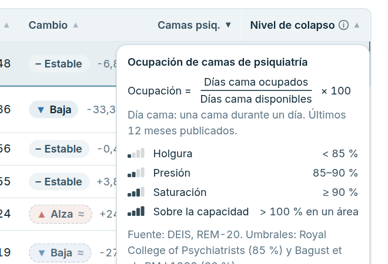

### 5.3 Ocupación de psiquiatría

Para los establecimientos con camas de psiquiatría, el panel muestra la ocupación mensual frente a la dotación declarada. Los niveles de alerta son:

| Color | Rango | Significado |
|---|---|---|
| Verde | < 85 % | Ocupación normal |
| Amarillo | 85–95 % | Alta ocupación |
| Rojo | > 95 % | Saturación |

### 5.4 Propuesta de camas

El panel de propuesta de camas muestra un escenario anual de cuántas camas serían necesarias para mantener la ocupación por debajo del umbral de alerta, dado el pronóstico de demanda. Este escenario es indicativo y no constituye una recomendación operacional.

---

## 6. Suicidios

La vista de suicidios muestra la serie de muertes por suicidio en la Región Metropolitana.

Incluye:
- Serie semanal observada.
- Pronóstico con intervalo de predicción.
- Tasa por 100 000 habitantes.
- Marcas de contexto (semanas con eventos relevantes).

> **Nota de interpretación:** los datos de suicidios tienen un desfase de registro mayor que los de urgencias. Las últimas semanas disponibles pueden cambiar en publicaciones posteriores del DEIS/MINSAL.

---

## 7. Caracterización

La vista de caracterización muestra la distribución por edad y sexo de las atenciones de urgencia por salud mental.

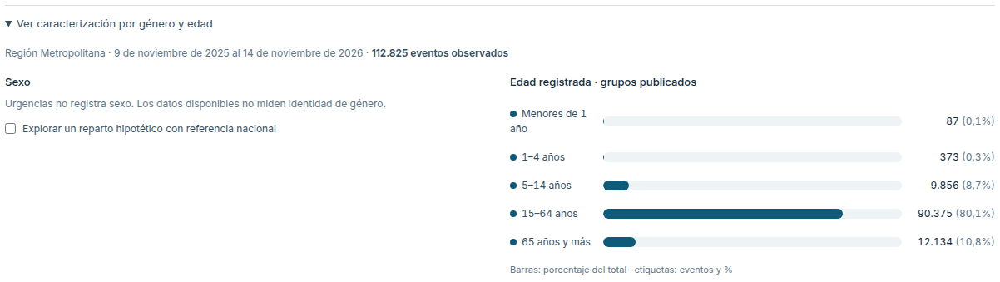

Incluye:
- Distribución etaria de las atenciones.
- Distribución por sexo (a partir de egresos como escenario hipotético; urgencias no registra sexo directamente).
- Defunciones registradas.

> **Advertencia:** el reparto por sexo en urgencias es un escenario hipotético calculado a partir de egresos nacionales por intento suicida, no un conteo observado directo.

---

## 8. Avisos, estados de carga y errores

La barra superior puede mostrar avisos de lectura cuando los datos tienen limitaciones conocidas:

- **«Pronóstico no vigente»:** el pronóstico fue generado con una versión de los datos que no coincide con la actual. Los valores son orientativos hasta que el equipo regenere el modelo.
- **«Vista temporal»:** se está mostrando una versión de datos que puede actualizarse próximamente.
- **Número de advertencias:** indica cuántas limitaciones o notas afectan al período visible.

Los estados de carga son:
| Estado | Significado |
|---|---|
| Cargando… | La API está respondiendo; espere unos segundos |
| Error de conexión | La API no está disponible; verifique la URL o contacte al equipo |
| Sin datos | El establecimiento o la comunidad no tiene datos suficientes para el período |

---

## 9. Tema oscuro y vista móvil

La aplicación detecta automáticamente el tema del sistema operativo (claro u oscuro).

También funciona en dispositivos móviles (pantallas de 360 px o más), aunque la experiencia óptima es de escritorio.

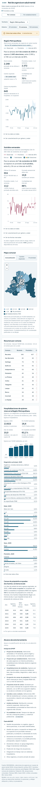

---

## 10. Glosario

| Término | Definición |
|---|---|
| **Atención de urgencia SM** | Atención registrada en el DEIS con código de salud mental (F00–F99) en el sistema de urgencias (ID36) |
| **ID36** | Identificador del formulario estadístico de urgencias del DEIS/MINSAL |
| **ID42** | Identificador del formulario de egresos hospitalarios derivados desde urgencias |
| **REM-20** | Resumen Estadístico Mensual de establecimientos; fuente del reporte de ocupación de camas |
| **Pronóstico** | Proyección estadística generada con un modelo evaluado por backtesting. No es un compromiso ni una certeza |
| **Intervalo de predicción al 80 %** | Rango en el que el 80 % de las semanas futuras debería caer, según el modelo. El 20 % restante puede quedar fuera |
| **MASE** | *Mean Absolute Scaled Error*: medida de error del modelo comparada con un baseline estacional |
| **SAPU** | Servicio de Atención Primaria de Urgencia |
| **SUR** | Servicio de Urgencia Rural |
| **CESFAM** | Centro de Salud Familiar |
| **Desfase de registro** | Las fuentes del DEIS/MINSAL se publican con rezago; los datos de las últimas semanas pueden cambiar en publicaciones posteriores |
| **Pipeline** | Proceso automatizado que descarga, normaliza y valida los datos y genera los pronósticos |
| **Corte de datos** | Última semana con datos observados disponibles en el sistema |

---

## 11. Preguntas frecuentes

**¿Con qué frecuencia se actualizan los datos?**
Los datos se actualizan manualmente cuando el equipo ejecuta el pipeline y publica los outputs con `subir_datos.sh`. No hay actualización automática programada.

**¿Los pronósticos son definitivos?**
No. Son proyecciones estadísticas con un intervalo de incertidumbre. Deben leerse como orientación, no como predicciones exactas. El intervalo al 80 % indica que 1 de cada 5 semanas puede quedar fuera del rango.

**¿Puedo exportar los datos?**
La versión actual no tiene función de exportación desde la interfaz. Los datos fuente están disponibles en el repositorio del proyecto para el equipo técnico.

**¿Por qué algunas comunas no aparecen en el mapa?**
El sistema cubre las 52 comunas de la Región Metropolitana con atenciones de salud mental registradas. Comunas con cero atenciones en el período no aparecen coloreadas.

**¿Qué significa «Vista temporal»?**
El sistema detectó que el pronóstico en memoria no coincide con las entradas actuales. Esto puede ocurrir cuando se actualizaron los datos sin regenerar el modelo. El equipo técnico debe regenerar el pronóstico con `forecast_demanda_sm`.

**¿La plataforma accede a datos de pacientes?**
No. Todos los datos son agregados o disociados. No hay información que permita identificar a personas individuales.

**¿Funciona sin conexión a internet?**
En la versión local (Docker Compose) la API y el frontend corren en la red local. En la versión AWS se requiere conexión a internet.

**¿Qué navegadores son compatibles?**
Chrome 120+, Firefox 120+ y Edge 120+. Safari tiene soporte limitado y puede mostrar diferencias visuales.
