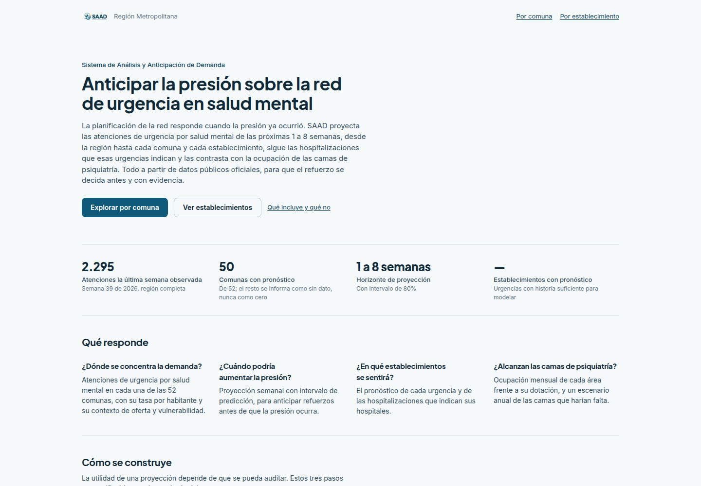
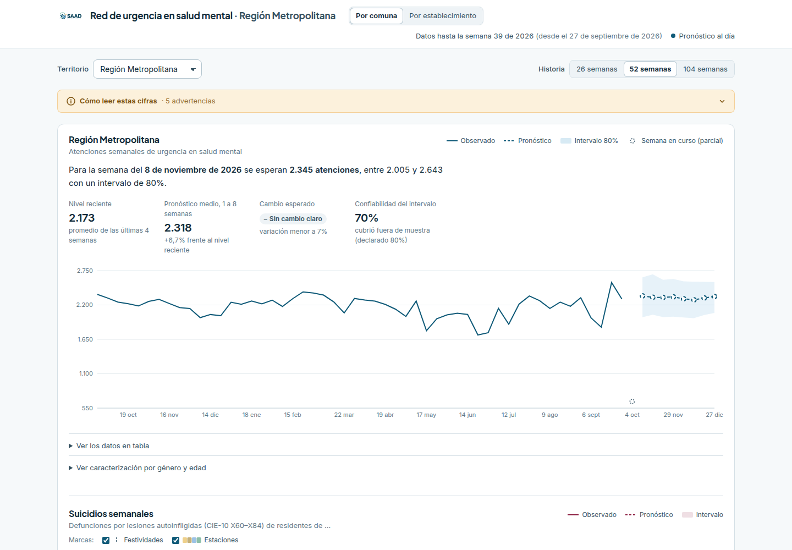
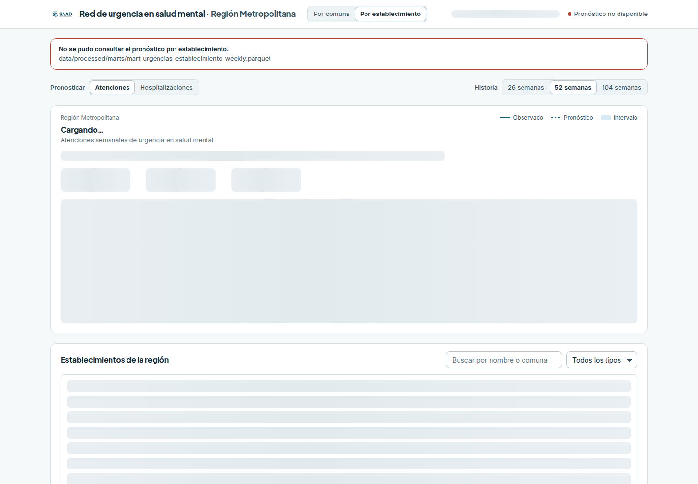

# Línea base local de SAAD con Docker Compose (C-07)

> Evidencia **solo del entorno local**. Sirve como control para contrastar el despliegue en AWS; no prueba AWS.

## Entorno

| Dato | Valor |
|---|---|
| Fecha (UTC) | 2026-11-12T14:31:46+00:00 |
| Commit | `3f1fd84` (rama `main`) |
| Cambios sin commit en el código | no |
| Máquina | 13th Gen Intel(R) Core(TM) i5-1335U, 12 núcleos, 15.3 GiB de RAM |
| Sistema operativo | Ubuntu 24.04.5 LTS (kernel 7.0.0-43-generic) |
| Docker / Compose | 29.6.1 / 5.3.1 |
| Python / Node del equipo | 3.12.3 / v22.15.1 |
| URL local | http://localhost:8080 |
| Comando | `scripts/qa_baseline_local.py` |

## Contenedores

| Servicio | Estado | Imagen | Id | Creada |
|---|---|---|---|---|
| api | Up 4 minutes (healthy) | `saad-api` | `sha256:7d9ebc1abafb` | 2026-11-12T10:00:19.166948526-03:00 |
| web | Up 4 minutes | `saad-web` | `sha256:d0c86065d635` | 2026-11-12T10:00:30.369555986-03:00 |

Versiones en el contenedor `api`: Python 3.12.16, FastAPI 0.141.1, pandas 3.0.5, PyArrow 25.0.1, LightGBM 4.7.0. `SAAD_USAR_PRONOSTICO_DESACTUALIZADO=1`.

## Dataset

La API lee 137 archivos (214.1 MB) de `data/processed/`, `reports/` y `data/raw/poblacion/`. Inventario con SHA-256 en [`dataset.csv`](dataset.csv); huella del conjunto: `c73822b169ab156d…`. Si la huella coincide, otro equipo está usando exactamente los mismos datos.

| Pronóstico persistido | Generado (UTC) | Modelo |
|---|---|---|
| `pronostico_demanda_sm_manifest.json` | 2026-11-10T23:00:32.504878Z | hibrido_glm_region_lgbm_comuna_conformal |
| `pronostico_establecimientos_sm_manifest.json` | 2026-11-10T23:03:10.133771Z | None |
| `pronostico_suicidios_manifest.json` | 2026-11-07T19:59:47.271239Z | poisson_estacional_eb_vm52 |

## Recorrido

**Resultado:** 10 aprobados · 4 fallidos de 14 casos.

| Caso | Prueba | Estado | Detalle |
|---|---|---|---|
| CP-SAAD-028 | Portal local (nginx) | **APROBADO** | HTTP 200 |
| CP-SAAD-017 | GET /api/v1/salud | **APROBADO** | HTTP 200 en 7.4 ms |
| CP-SAAD-018 | GET /api/v1/meta | **APROBADO** | HTTP 200 en 173.6 ms |
| CP-SAAD-019 | GET /api/v1/territorios | **APROBADO** | HTTP 200 en 12.2 ms |
| CP-SAAD-020 | GET /api/v1/series/RM | **APROBADO** | HTTP 200 en 21.9 ms |
| CP-SAAD-021 | GET /api/v1/series/99999 | **APROBADO** | HTTP 404 en 6.0 ms |
| CP-SAAD-022 | GET /api/v1/pronosticos | **APROBADO** | HTTP 200 en 9.6 ms |
| CP-SAAD-023 | GET /api/v1/resumen-comunal | **APROBADO** | HTTP 200 en 33.6 ms |
| CP-SAAD-024 | GET /api/v1/geo/comunas | **APROBADO** | HTTP 200 en 11.2 ms |
| CP-SAAD-025 | GET /api/v1/camas-psiquiatria/RM | **FALLIDO** | HTTP 404 (se esperaba 200); detalle de la API: Falta la dotacion de camas: ejecute el stage `build_dim_camas_psiquiatria_hospital_rm` del pipeline. |
| CP-SAAD-026 | GET /api/v1/calendario-eventos?desde=2025-11-01&hasta=2026-12-31 | **APROBADO** | HTTP 200 en 52.6 ms |
| CP-SAAD-037 | GET /api/v1/establecimientos | **FALLIDO** | HTTP 503 (se esperaba 200); detalle de la API: data/processed/marts/mart_urgencias_establecimiento_weekly.parquet |
| CP-SAAD-037 | GET /api/v1/establecimientos-meta | **FALLIDO** | HTTP 503 (se esperaba 200); detalle de la API: data/processed/marts/mart_urgencias_establecimiento_weekly.parquet |
| CP-SAAD-047 | GET /api/v1/suicidios/RM | **FALLIDO** | HTTP 503 (se esperaba 200); detalle de la API: El pronóstico de suicidios está desactualizado (falta la entrada 'mart_suicidios_comuna_weekly' (data/processed/marts/mart_suicidios_comuna_weekly.parquet)): ejecute el stage `forecast_suicidios` del pipeline. |

## Limitaciones explícitas

- **GET /api/v1/camas-psiquiatria/RM:** HTTP 404 (se esperaba 200); detalle de la API: Falta la dotacion de camas: ejecute el stage `build_dim_camas_psiquiatria_hospital_rm` del pipeline.
- **GET /api/v1/establecimientos:** HTTP 503 (se esperaba 200); detalle de la API: data/processed/marts/mart_urgencias_establecimiento_weekly.parquet
- **GET /api/v1/establecimientos-meta:** HTTP 503 (se esperaba 200); detalle de la API: data/processed/marts/mart_urgencias_establecimiento_weekly.parquet
- **GET /api/v1/suicidios/RM:** HTTP 503 (se esperaba 200); detalle de la API: El pronóstico de suicidios está desactualizado (falta la entrada 'mart_suicidios_comuna_weekly' (data/processed/marts/mart_suicidios_comuna_weekly.parquet)): ejecute el stage `forecast_suicidios` del pipeline.
- **Advertencia de la API:** Las cifras son atenciones de urgencia (eventos), no personas únicas ni prevalencia.
- **Advertencia de la API:** Intervalo 80%: fuera de muestra cubrió 70% en el nivel regional. Interpretar los límites como orientativos.
- **Advertencia de la API:** Intervalo 80%: fuera de muestra cubrió 77% en el nivel comunal. Interpretar los límites como orientativos.
- **Advertencia de la API:** 2 comuna(s) sin pronóstico por falta de datos; se muestran como 'sin pronóstico', nunca como cero.
- **Advertencia de la API:** Vista temporal: se muestra un pronóstico guardado que no está vigente porque cambió 'seleccion_benchmark' respecto del snapshot con que se generó. Sus cifras pueden no corresponder al modelo seleccionado.

## Capturas

## Logs

Últimas líneas de cada contenedor: [`logs/api.log`](logs/api.log), [`logs/web.log`](logs/web.log).
