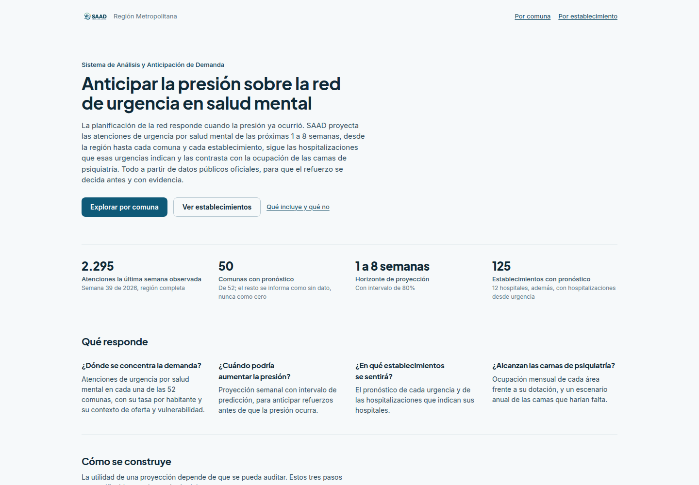
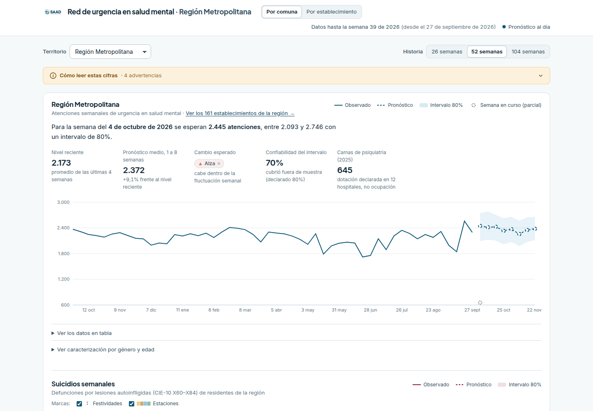
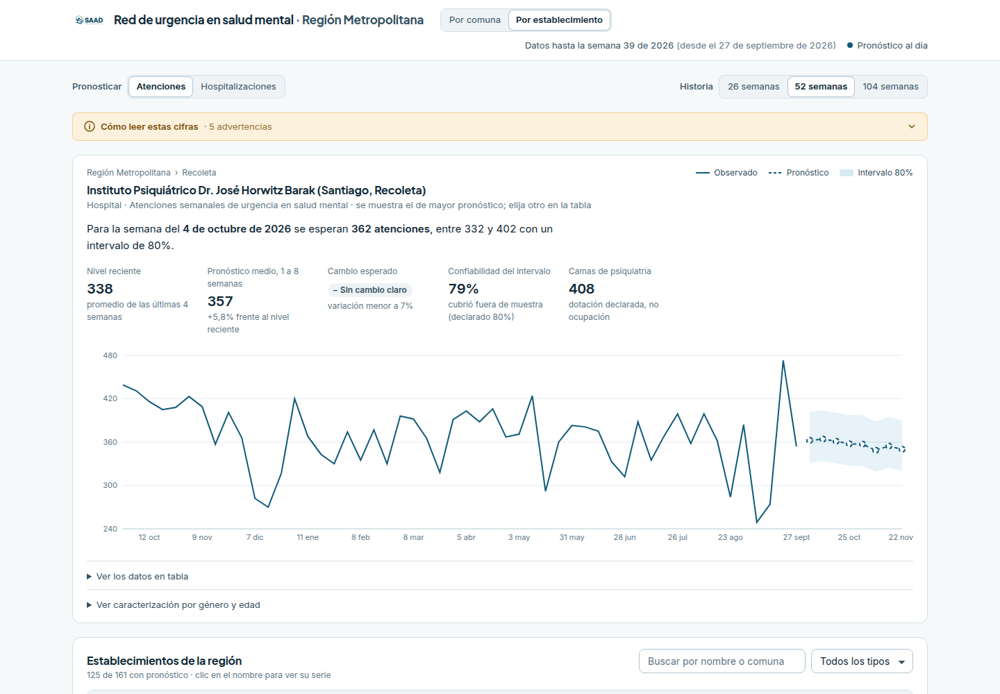

# Prueba end-to-end AWS contrastada con línea base local (C-44)

- **Fecha (UTC):** 2026-11-12T15:27:07+00:00
- **Commit del repositorio:** `95d00f8`
- **Imagen en servicio:** `saad-api:95d00f8`
- **LOCAL:** http://localhost:8080 (Docker Compose)
- **AWS:** CloudFront → ALB → ECS Fargate, región us-east-1. La URL existe y está registrada para el equipo, pero no se publica en el repositorio.
- **Ejecutado con:** `scripts/qa_e2e_local_vs_aws.py`

**Resultado:** 24 aprobados · 0 fallidos · 0 bloqueados · 7 no ejecutados. Los no ejecutados no cuentan como aprobados.

## Casos

| Caso | Prueba | Entorno | Estado | Detalle |
|---|---|---|---|---|
| CP-SAAD-017 | GET /api/v1/salud | LOCAL+AWS | **APROBADO** | Igual en LOCAL y AWS |
| CP-SAAD-018 | GET /api/v1/meta | LOCAL+AWS | **APROBADO** | Igual en LOCAL y AWS |
| CP-SAAD-019 | GET /api/v1/territorios | LOCAL+AWS | **APROBADO** | Igual en LOCAL y AWS |
| CP-SAAD-020 | GET /api/v1/series/RM | LOCAL+AWS | **APROBADO** | Igual en LOCAL y AWS |
| CP-SAAD-021 | GET /api/v1/series/99999 | LOCAL+AWS | **APROBADO** | Igual en LOCAL y AWS |
| CP-SAAD-022 | GET /api/v1/pronosticos | LOCAL+AWS | **APROBADO** | Igual en LOCAL y AWS |
| CP-SAAD-023 | GET /api/v1/resumen-comunal | LOCAL+AWS | **APROBADO** | Igual en LOCAL y AWS |
| CP-SAAD-024 | GET /api/v1/geo/comunas | LOCAL+AWS | **APROBADO** | Igual en LOCAL y AWS |
| CP-SAAD-025 | GET /api/v1/camas-psiquiatria/RM | LOCAL+AWS | **APROBADO** | Igual en LOCAL y AWS |
| CP-SAAD-026 | GET /api/v1/calendario-eventos?desde=2025-11-01&hasta=2026-12-31 | LOCAL+AWS | **APROBADO** | Igual en LOCAL y AWS |
| CP-SAAD-037 | GET /api/v1/establecimientos | LOCAL+AWS | **APROBADO** | Igual en LOCAL y AWS |
| CP-SAAD-037 | GET /api/v1/establecimientos-meta | LOCAL+AWS | **APROBADO** | Igual en LOCAL y AWS |
| CP-SAAD-047 | GET /api/v1/suicidios/RM | LOCAL+AWS | **APROBADO** | Igual en LOCAL y AWS |
| CP-SAAD-001 | Portal por HTTPS y CloudFront | AWS | **APROBADO** | HTTP 200, certificado TLS validado por el cliente, servido por 1.1 b59c4d23116ded2d758f8a7688e0b9e2.cloudfront.net (CloudFront) |
| CP-SAAD-060 | HTTP redirige a HTTPS | AWS | **APROBADO** | HTTP 301 → <URL_AWS>/ |
| CP-SAAD-003 | CloudFront enruta /api/* al ALB | AWS | **APROBADO** | HTTP 200, content-type application/json, cache Miss from cloudfront |
| CP-SAAD-004 | Bucket del sitio privado (acceso anónimo directo a S3) | AWS | **APROBADO** | Acceso anónimo: HTTP 403 (se esperaba 403) |
| CP-SAAD-062 | Bucket de datos privado (acceso anónimo directo a S3) | AWS | **APROBADO** | Acceso anónimo: HTTP 403 (se esperaba 403) |
| CP-SAAD-062 | ALB inaccesible salvo desde CloudFront | AWS | **APROBADO** | Conexión directa al ALB rechazada o sin respuesta (TimeoutError) |
| CP-SAAD-005 | Tareas ECS en ejecución | AWS | **APROBADO** | running=1 desired=1, despliegue COMPLETED |
| CP-SAAD-007 | Imagen ECR trazable a un commit | AWS | **APROBADO** | Imagen saad-api:95d00f8; commit del repositorio al probar: 95d00f8. Tarea 512 CPU / 2048 MiB |
| CP-SAAD-008 | Solicitudes y errores registrados en CloudWatch | AWS | **APROBADO** | 200+ eventos en la última hora (se leen hasta 200); 0 con [ERROR] o Traceback |
| CP-SAAD-008 | Alarmas de CloudWatch configuradas | AWS | **APROBADO** | 7 alarmas; en ALARM: ninguna |
| CP-SAAD-063 | Sin secretos en el frontend publicado | AWS | **APROBADO** | Revisados index.html y 1 archivos JS: sin coincidencias |
| CP-SAAD-065 | Recuperación tras reemplazo de tarea ECS | AWS | **NO EJECUTADO** | Se ejecuta con --reinicio porque reemplaza la tarea en servicio. |
| CP-SAAD-011 | Refresh semanal manual | AWS | **NO EJECUTADO** | No aplica en Fargate: el pipeline corre en el equipo y se publica con subir_datos.sh (cambio de alcance de C-42). |
| CP-SAAD-012 | EventBridge dispara la tarea | AWS | **NO EJECUTADO** | No aplica: no hay tarea programada (pipeline local). |
| CP-SAAD-013 | Falla de etapa no promueve artefactos | AWS | **NO EJECUTADO** | No aplica en AWS: el pipeline no corre en Fargate. |
| CP-SAAD-014 | Nuevos outputs visibles tras redespliegue | AWS | **NO EJECUTADO** | Requiere publicar datos nuevos con subir_datos.sh; no se hizo en esta corrida. |
| CP-SAAD-015 | 503 y Retry-After durante la inicialización | AWS | **NO EJECUTADO** | No observable desde fuera: el despliegue mantiene la tarea anterior hasta que la nueva está sana. Cubierto por pruebas unitarias de la API (tests/test_api.py). |
| CP-SAAD-016 | Almacenamiento efímero del pipeline | AWS | **NO EJECUTADO** | No aplica: el pipeline no corre en Fargate. |

## Comparación LOCAL / AWS por endpoint

| Endpoint | HTTP local | HTTP AWS | ms local | ms AWS | ¿Equivalentes? |
|---|---|---|---|---|---|
| `/api/v1/salud` | 200 | 200 | 3.6 | 291.3 | sí |
| `/api/v1/meta` | 200 | 200 | 11.3 | 195.1 | sí |
| `/api/v1/territorios` | 200 | 200 | 5.5 | 300.8 | sí |
| `/api/v1/series/RM` | 200 | 200 | 10.5 | 301.4 | sí |
| `/api/v1/series/99999` | 404 | 404 | 3.3 | 131.1 | sí |
| `/api/v1/pronosticos` | 200 | 200 | 9.8 | 176.8 | sí |
| `/api/v1/resumen-comunal` | 200 | 200 | 20.4 | 304.1 | sí |
| `/api/v1/geo/comunas` | 200 | 200 | 12.3 | 406.7 | sí |
| `/api/v1/camas-psiquiatria/RM` | 200 | 200 | 4.9 | 265.9 | sí |
| `/api/v1/calendario-eventos?desde=2025-11-01&hasta=2026-12-31` | 200 | 200 | 3.4 | 254.1 | sí |
| `/api/v1/establecimientos` | 200 | 200 | 284.8 | 1810.5 | sí |
| `/api/v1/establecimientos-meta` | 200 | 200 | 12.8 | 175.8 | sí |
| `/api/v1/suicidios/RM` | 200 | 200 | 15.0 | 283.8 | sí |

## Capturas

## Defectos para C-06

- Ninguno en esta corrida.

Evidencia completa por caso en `resultados.json`.
